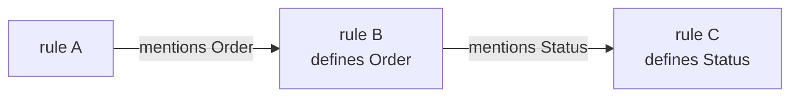

# Operating procedure for agents

Each application starts at `spec/index.md`: its stories, rules and Quint
model, with links to child specs wherever an area needs its own directory.
`gen/` is derived from it. Keep the spec true to what the user wants and
`npm run check` green.

**Read this file and [README.md](README.md) in full before doing any work.**
The spec format, naming rules and everything the tools accept are in
[Spec reference](#spec-reference) below.

## Who does what

`npm run check` detects; you translate: story → rules, rule → Quint, changed
Quint → prose, counterexample → rule. That is your work in this session; it
needs no other program or account.

**Whenever `spec/` or `src/` has changed, follow
[.claude/skills/sync/SKILL.md](.claude/skills/sync/SKILL.md)**: the loop, what
each failure asks of you, and what to report. Claude Code loads it as the
`sync` skill; other agents read the file.

The user signs off with `npm run accept`.

## Hard rules

- Never edit `gen/`, `.spec-cache/`, `.studio/` or `spec/lock.json`, and never add a
  `lemmascript.json`. The tools own them; a change there could make a check
  pass that should not.
- Never run `npm run accept -- unproved` unless the user asks. It lowers the
  listed obligations from proved to simulated.
- Run `npm run accept` only when the user asks, and only after reading each
  rule `review` lists and finding that its prose and Quint say the same thing.
- Never weaken or delete a rule (`always`, `step`, `sometimes` or `law`) to
  make a check pass without telling the user which rule and why.
- Proving obligations is your work, in `spec/<path>.proof.dfy` or
  `src/<path>.proof.dfy` ("Proof files", below). Satisfy a check;
  never get past it: no trust or skip annotations, no edits to the tools or
  what they generate, no workaround for what a proof file may not contain.
- Verified logic belongs in the spec as `pure def`. Hand-write TypeScript in
  `src/` only for what Quint cannot express or what touches the outside world.

## Writing code

Check each point before you write, and again after.

- **Design.** Anything a person looks at follows
  [.claude/skills/design/SKILL.md](.claude/skills/design/SKILL.md).
- **One path.** Replace old code; do not keep it beside its replacement. No
  feature flags, environment variables or settings for a change.
- **Reuse.** Search for existing code and types first. Extend and share; no
  duplicates or one-offs.
- **Compact.** Reread for needless branches, `try` blocks, wrappers and
  indirection. Shorter, if it reads as well.
- **Comments** point to related code or to the spec rule a line serves. Never
  describe what changed or was added.
- **Scripts and tests.** Extend existing ones before adding; no new scripts.
  Delete code that becomes unused. Tests follow "Tests" below.
- **Speed.** Keep checks and CI fast: a small change reruns only what it
  touches; a full run is as quick as it can be.
- **Passes.** The first version is a draft. Review it two or three times
  against these points.

## Tests

The spec proves the rules for every state and input; a test covers only what
`npm run check`'s other stages cannot see: hand-written code meeting the
outside world. Write one only when its failure would be a bug a user meets
and nothing else would catch it.

| Earns a test | Never a test |
|---|---|
| A whole user journey, or an integration with a real service, through the real shell: input parsing, storage, HTTP, UI wiring | A guard, transition, rule or law the spec already proves, except as a step of a journey |
| Hand-written code that touches the outside world, through the journey that uses it. Pure logic becomes a `pure def` or gets a `//@` contract instead | Strings, labels, page titles, markup, styles, snapshots |
| A shell bug that was found: one more step in the journey it broke | That a function was called; what `tsc` already checks |

- **Journeys.** A test walks a story end to end, is named after it, and cites
  the rule each assertion serves (`// spec/index.md, "…"`). A story whose
  path never leaves the verified core needs none.
- **Real services.** Run the real database, server, queue and filesystem,
  started and reset by the `test` script or the runner's setup: an in-process
  database such as PGlite, a container, a local emulator, a provider's test
  mode. Fake only a service that costs money, cannot
  be undone, or cannot be run and reset locally; fake it once, at its network
  boundary, shared by every test. No mocks of your own code.
- **Extend before adding.** A step or assertion in an existing journey before
  a new test; a new test before a new file. A test that repeats another's
  setup to assert one more thing belongs inside it.
- **Compact.** Shared helpers over repeated setup, one assertion of a whole
  value over one per field, no comment that restates the test's name.
- **One command.** `npm run check` runs the package's `test` script, which
  runs the tests and never the check. No other test scripts, and nothing a
  person must set to run them; the config a runner or service needs is fine.
- **Size.** One file per package and runner is the norm, and 5,000 lines is fine. At
  15,000 lines, consolidate and simplify; split only at 20,000.
- **Never weaken a test to pass.** Fix the code. If the spec now asks for
  something else, change the assertion and name it and its rule in your
  report. Propose deleting a test; never delete one yourself.

How `npm run check` runs them:

- **Any runner.** It runs the package's `test` script with the package
  manager named by `packageManager` in `package.json`, or else by the lock file
  in the package or a directory above it: `node --test`, Vitest, Jest,
  `bun test` and Playwright all work. Without a `test` script it runs
  `node --test` on `test/**/*.test.ts`. The exit code decides; a failure shows
  the runner's summary of failures, or its last 80 lines.
- **Citations.** A test, or a shell file in `src/`, names the story or rule it
  serves by its heading, on one line:
  `// spec/index.md, "A payment never exceeds the balance"`, or
  `// spec/index.md, "Story: Check out"` for a story; several may share a line,
  separated by `;`. `check` fails on a
  citation whose heading the spec no longer has, so a renamed or removed rule
  brings its tests up for review.
- **Monorepos.** Each package with a `spec/` runs its own `check` and its own
  tests; run them all from the root with the workspace tool
  (`pnpm -r --if-present check`, `npm run check --workspaces --if-present`).
  A journey that crosses packages is tested in the package that owns it,
  usually the app.

## Definition of done

- `npm run check` is where step 3 of the sync skill's loop stops: what is
  left waits on the user.
- In the vibespec-starter repository, if you changed `vibespec/`, `npm run selftest`
  passes, with a new case for each new kind of mistake the change catches.
- What you wrote has had its passes under "Writing code".
- Your summary follows "When you stop" in the sync skill.

# Spec reference

The spec format, the generated code and the code built on it. The agent's
loop is the [`sync` skill](.claude/skills/sync/SKILL.md); setup and the stages
of `npm run check` are in [README.md](README.md).

In the vibespec-starter repository, "the order example" is
`vibespec/examples/order/spec/index.md` and "the tracker example" is
`vibespec/examples/dashboard/spec/tracker.md`. The root `spec/index.md` is blank, ready
for a new application.

## Writing a spec

`npx spec new` fills an empty `spec/index.md` with a starter that passes every
stage but `review`. `npx spec new <name>` writes `spec/<name>/index.md`;
nested names such as `billing/payments` are allowed. A non-empty spec is
never replaced.

`check` reads every `spec/**/*.md`, including child directories. A spec may
link to another with `[Payments](./payments/)` or
`[Currency](../shared/currency.md)`. Directory links resolve to `index.md`;
references stay inside `spec/`. Links organize the spec; Quint imports bring
in definitions. An empty index or one containing only navigation links is
valid. A `##` story still needs rules.

Each path component uses `[a-z][A-Za-z0-9]*`. The generated module name is
the path relative to `spec/`, without `.md` or a trailing `/index`, with
slashes replaced by `__`: `spec/index.md` becomes `gen/index.ts`,
`spec/billing/index.md` becomes `gen/billing.ts`, and
`spec/billing/payments.md` becomes `gen/billing__payments.ts`. Flat files
remain supported. Two paths cannot name the same module, so use either
`spec/billing.md` or `spec/billing/index.md`.

````markdown
# Order checkout                         <- title, free text

## Story: Check out                      <- a story

> As a shopper, I want to …              <- the story's text

### Only a non-empty draft can be submitted      <- a rule: one checkable sentence

Submitting freezes the order.            <- the rule's prose, optional

```quint
pure def canSubmit(o: Order): bool = o.status == Draft and o.units > 0
pure def submit(o: Order): Order = { ...o, status: Pending }
```
````

| Line | Means |
|---|---|
| `## …` | a story, or any group of rules. Needs at least one rule. Its text runs to its first `###` |
| `### …` | a rule, keyed `<story> / <heading>`, unique in the spec. Needs a `quint` block |
| `` ```quint `` | the rule's formal half; only under a `###` |
| any other fence | prose; `##` and `###` inside it are not headings |
| `####`, bold, anything else | prose of the rule or story above |

A fence is three or more backticks or tildes. It closes only on a line of
the same character, at least as long, with nothing after it, so a fence of
four backticks can hold a ```` ```quint ```` example. A fence is Quint when
the first word of its info string is `quint`.

Quint errors are reported at the source file's path and `line:col`.

### What goes in the Quint blocks

Only types, imports, `pure val` and `pure def`. There is no `var`, no
`action`, and no `init` or `step`: the state machine around your definitions
is generated. The role of a definition comes from its name and signature:

| You write | It is | Generated from it |
|---|---|---|
| `type Order = { … }`, `type Status = A \| B` | the vocabulary | `interface Order`, `type Status = "A" \| "B"` |
| `pure val initial: Order = …` | the initial state; its type is *the state type*. A spec without one is a library | `initial`, `parseState`, and a proof that it satisfies every `always` rule |
| `pure def pay(o: Order, amount: int): Order` | a transition: any `pure def` whose first parameter is the state and that returns the state | `pay(o, amount)`, an `Event` variant `{ type: "pay", amount }`, a case in `step`, `enabled` and `parseEvent`, and proofs that it preserves every rule |
| `pure def canPay(o: Order, amount: int): bool` | the guard of `pay`; takes the state and any subset of its other parameters, matched by name and type | `canPay`, used by `enabled` and `step`. What is proved about `pay` is proved for the cases the guard allows. A guard may call its own transition to look at the result |
| `pure def alwaysPaidWithinDue(o: Order): bool` | a rule that holds in every reachable state | a conjunct of `inv`; simulated and proved |
| `pure def stepNeverGoesBack(before: Order, after: Order): bool` | a rule about every single step | a postcondition on every transition; simulated and proved |
| `pure def stepAuthorized(before: Order, via: str, after: Order): bool` | a step rule that also sees the transition name | a postcondition on every transition |
| `pure def sometimesPaid(o: Order): bool` | a state that must be reachable | a reachability check with a witness trace |
| `pure def leadsToPaid(o: Order, later: Order): bool` | a liveness rule: from every reachable state `o`, every fair run reaches a state `later` that it relates to `o` (`o` itself counts) | a search of simulated traces for a fair run that breaks it ("Liveness", below) |
| `pure def lawTotalIsNotNegative(xs: List[int]): bool` | a law: true for every value of its parameters | a function proved to return `true`, and sampled by the simulator |
| `pure val idValues = Set(1, 2, 3)` | what the simulator tries for a parameter named `id`. It must be a set whose elements match the parameter type; any supported Quint is allowed in it | nothing: it never reaches TypeScript |

| `pure val weight_pay = 5` | how often the simulator tries `pay`: a whole number from 1 to 100, times as often as an event of weight 1 (the default). For deep interleavings, such as a message lost, repeated and reordered | nothing |
| `pure val fair_pay = "weak"` or `"strong"` | an assumption for `leadsTo` rules: a fair run does not put `pay` off for ever while its guard keeps allowing it (`"weak"`), or while it allows it again and again (`"strong"`) | nothing |
| any other `pure val` or `pure def` | a constant or helper | the same constant or function |

A transition parameter named `by` identifies its sender. All such parameters
use the same type. It is supplied separately as `enabled(current, event, by)`
and `step(current, event, by)`; it never comes from `parseEvent`. The shell
must validate the authenticated sender before supplying it.

A helper that takes the state first and returns the state would be taken for
a transition. Give it the state as its second parameter, or return something
smaller.

A transition may return a named record `{ state: State, out: List[Effect] }`.
All transitions that return effects use the same record type. In that module,
`step` returns that record; state-only transitions and rejected events return
an empty `out`. A step rule may take a final parameter named `out` to inspect
the effects, after the resulting state. The simulator compares those effects
with the generated TypeScript, and the proof checks each such step rule.

Refused, each with a message saying why: the generated and harness names
(`init`, `step`, `inv`, `enabled`, `parseEvent`, `parseState`, `Event`,
`current`, `event`, `state`, …) and `ProofLib`; JavaScript globals and
keywords (`Number`, `delete`, …); Quint built-ins (`to`, `next`, `all`,
`size`, …); a parameter named like a variant; a variant field called `tag`;
and near-misses of the conventions above such as `alwayspaid` or `CanPay`.

### Using one spec from another

- **`import kernel.* from "./kernel"`** takes a library's names as they are.
  A library is a spec with no `initial`: definitions and laws, or a
  *component* such as an account with `canWithdraw` and `withdraw` and no
  state of its own (`vibespec/fixtures/account.md` in the vibespec-starter repository,
  used by `bank.md`).
- **`import lamp as L from "./lamp"`** takes any spec under a name, a state
  machine included. A room can then hold two `L::Lamp`s in its state, start
  them from `L::initial`, move them with `L::toggle`, require
  `L::alwaysFlipsAreCounted` of each, and add rules about the pair that
  neither lamp could state (`vibespec/fixtures/room.md` in the vibespec-starter
  repository).

Import paths resolve relative to the spec that contains them. For example,
`import currency.* from "../shared/currency"` uses a sibling area's library,
and `import payments as P from "./payments"` uses `payments/index.md`.
Generated code uses the imported spec's full module path.
- **`import net as N from "./net"`** takes a spec that ships with the tools,
  from their `std/` directory, when `spec/` has none of that name. It is
  simulated and proved with the specs that import it, never reviewed.
  [`vibespec/std/net.md`](vibespec/std/net.md) is a network that loses, repeats and reorders:
  the numbers of the messages in flight, with `N::send`, `N::take` (to
  deliver or lose one), `N::repeat`, and laws for an `always` rule that only
  messages sent are in flight. `vibespec/fixtures/ping.md` uses it.

A spec is imported once, one way or the other, and imports cannot form a
circle. Navigation links may point back to a parent. In the generated
TypeScript a name from another module is spelled
`<module>_<name>`, for example `lamp_toggle`.

### Supported Quint

| In a spec | In TypeScript | Notes |
|---|---|---|
| `int`, `bool`, `str` | `number`, `boolean`, `string` | Integer literals must fit in 2^53 |
| records | interfaces | Nest as deep as you like |
| `type Status = Draft \| Paid` | `"Draft" \| "Paid"` | |
| `type Parcel = Packed({ weight: int }) \| Lost` | `{ tag: "Packed"; weight: number } \| { tag: "Lost" }` | Read with `match p { \| Packed(x) => … \| _ => … }` |
| `List[T]` | `T[]` | `List(…)`, `append`, `concat`, `length`, `nth`, `nthOr`, `removeAt`, `head`, `tail`, `select`, `foldl`, and `every`, `some`, `includes`, `listMap` |
| `Set[T]` of simple values | `T[]` that never holds a value twice | `Set(…)`, `union`, `intersect`, `exclude`, `filter`, `map`, `forall`, `exists`, `contains`, `in`, `subseteq`, `size` |
| `K -> T` | `Record<K, T>` | Keys are integers, strings or plain variants; `Map()`, `put`, `get`, `getOr`, `m.keys().contains(k)` |

Also: `+ - * / %`, comparisons, `and or not implies iff`, `if … else`, record
construction, spread update and field access, calls to your own definitions,
and `val` bindings at the top of a definition. Anything else stops the `model`
stage with the name of the construct.

- **`==` and `includes` compare records, lists, maps and variants by structure.**
  A value holding a set cannot use structural equality; compare sets with
  `subseteq` in both directions.
- **Generated arithmetic refuses an integer result outside the safe range.**
  It throws `RangeError` rather than returning a rounded JavaScript number.
- **`xs.nthOr(i, fallback)` and `m.getOr(k, fallback)` are total lookups.**
  `xs.removeAt(i)` removes one position, or leaves the list unchanged when
  the position is outside it.
- **Guard every partial operation in the definition that uses it.** An index
  outside a list, a missing map key and a zero divisor stop the simulator and
  cannot be proved safe. Test first and give a default, as `problemAt` does
  in the tracker example. For a map the form is exactly
  `if (m.keys().contains(k)) m.get(k) else 0`.
- **`/` and `%` go towards zero**, as in Quint: `-7 / 2` is `-3` and `-7 % 2`
  is `-1`. The generated TypeScript and the proofs agree.
- **There are no loops and no recursion.** To repeat something until done,
  fold over a list that is long enough, as `ancestors` does in the tracker
  example. What needs a real loop is written by hand in `src/` and proved
  there.
- **A set holds simple values only**, and `Set(a, b)` with members that are
  not literals is refused, because the two could be equal: write
  `Set(a).union(Set(b))`. Use a set when duplicates are impossible in the
  real thing and a list when they are not.
- **A map is a lookup table.** It cannot be listed or iterated; keep a list of
  keys beside it, or use a list of records with a key field. An event cannot
  carry one. In the generated state a string key carries a `$` in front, so
  that no key can collide with a property every JavaScript object has.
- **In a `match` arm, use the fields of what the variant carries**
  (`x.weight`), or rebuild the variant (`Packed({ ...x, weight: 2 })`). The
  carried value cannot be passed on whole. `match` must be on a name.
- **`every`, `some`, `includes` and `listMap` are not Quint.** They are
  rewritten into `foldl` before Quint reads the spec, because Quint evaluates
  a definition that takes a lambda wrongly when it is used inside its own
  argument.
- **The simulator tries small values**: integers −1…6, both booleans, three
  strings, every variant of a plain sum type, and short lists and sets of
  those. Define `<param>Values` to choose, which a record or a variant that
  carries data needs. The sets of an imported spec apply too; the spec's own
  win.

### Writing good rules

- `always` rules alone are satisfied by a system that does nothing. Add a
  `sometimes` rule for each kind of state a story is meant to make possible.
- A guard that never allows its event makes it impossible, and every rule
  then holds of it trivially. `check` fails when no simulated state allows
  one. It also lists guards it never saw refuse their event: such a guard
  often only restates an `always` rule, which is fine when it protects
  `enabled` from outside input, or refuses only beyond the simulator's 20
  events.
- `always` rules must hold *inductively*: from any state that satisfies all of
  them, every transition must lead to a state that satisfies all of them. If
  simulation passes but `proof` fails on a transition, a fact about which
  states are reachable is unstated. In the order example, "Drafts and
  cancelled orders hold no money" is such a fact: delete it and no simulated
  trace fails, but `submit` can no longer be proved to leave a balance.
- Keep simulation bounds out of guards. A guard such as "stop after day 6"
  ends up in the generated code. Bound the simulator with `<param>Values`.
- Compute something once with a `val` when a rule uses it several times;
  repeated folds are what make simulation slow.

### Liveness

A `leadsTo` rule says something happens, not only that nothing bad does:
`leadsToPaid(o, later) = o.status == Pending implies later.status == Paid`.
Its runs are the simulated traces of the `always` stage, each continued for
ever in one of two ways: it stops at a state, or it returns to a state it
had reached before and repeats the loop. Either is *fair* unless it puts off
a fair event: one declared `fair_<event>`, `"weak"` if the event's guard
allows it in every state of the loop (or in the state it stops at),
`"strong"` if in any. A fair run breaks the rule when some state on it is
followed by none the rule relates it to, and `always` fails with that run,
the state marked.

- Without a `fair_` declaration nothing has to happen, so a run may stop
  anywhere: declare fair the events the property waits on, the system's own
  steps and the deliveries the environment promises, and no others.
- An event lost and sent again forever loops; only `"strong"` fairness of
  the delivery rules that out (`vibespec/fixtures/ping.md`).
- "Allows" is for the values the simulator tries (`<param>Values`).
- A loop needs a state reached twice. A counter that only grows rules loops
  out, and then only runs that stop are checked: the stage says how many
  loops it found. Nothing proves a `leadsTo` rule.

### Review

`npm run accept` records a fingerprint of everything a person has
reconciled; `review` lists what differs. What each status asks of the agent
is in the [`sync` skill](.claude/skills/sync/SKILL.md).

| What | Recorded in, under | Fingerprint of | Statuses |
|---|---|---|---|
| document | `spec/lock.json`, `specs[<path>]["@document"]` | title, introduction and links before the first story, whitespace collapsed | `document changed` |
| story | `spec/lock.json`, `specs[<path>]["## <title>"]` | its text, whitespace collapsed | `story has no rules`, `new story`, `story changed`, `removed or renamed` |
| rule | `spec/lock.json`, `specs[<path>][<story> / <heading>]` | 1. its prose, whitespace collapsed<br>2. its Quint<br>3. the Quint of every rule it relies on | `not formalized` (no Quint), `new`, `prose changed`, `model changed`, `model changed through <names> (<rule>)`, `prose and model both changed`, `removed or renamed` |
| contract | `spec/lock.json`, `contracts["src/<path>.ts"]` | its `//@` lines and the declarations they belong to | `new contract`, `contract changed`, `contract removed` |



A rule relies on every rule whose Quint defines a name (definition, type or
variant) that its own Quint mentions, transitively and across imports. Above,
editing C's Quint makes A and B `model changed through Status (…C)`; a rule in
another spec is named `spec/<file>: <rule>`. A renamed heading is one rule
removed and one new.

The versioned `spec/lock.json` holds `specs` keyed by source path, `contracts`
keyed by source file, and `unproved` keyed by proof unit. `npx spec migrate`
consolidates older per-spec ledgers without accepting new reviews or proof
exceptions. Commit the resulting lock with the specs.

Removed spec paths stay in review until their removal is accepted.

Accept records everything or nothing: only when every other stage passes,
every story has a rule and every rule has Quint.

### When a proof does not go through

Dafny proves arithmetic and simple list facts on its own. It usually cannot
prove a rule that depends on a fold, a count or a search without help. When
`proof` lists obligations as "not proved" although simulation found nothing,
for each one, in this order:

1. **Prove it** in the unit's proof file (next section). This is the agent's
   work, like any other translation.
2. **State the missing fact**, if the obligation is false for some state that
   satisfies every rule: no proof can help then. Add it as an `always` rule
   or a law (the inductiveness case above). Moving arithmetic into a small
   function with a law in a library spec, or writing a loop by hand in
   `src/`, also gives Dafny smaller steps.
3. **Accept simulation for it**: the user's decision, never the agent's, and
   only for a spec unit: nothing simulates hand-written code, so a `src`
   unit's obligations must be proved.
   `npm run accept -- unproved` records the obligations in
   `spec/lock.json` under `unproved`, per unit, with a fingerprint of the
   unit's text and proof file. The check then passes and says how many obligations are
   simulated only. It fails again if a *new* one appears, or if the unit or
   its proof file changes: what was accepted for one text does not carry over
   to another. Read the list before recording it: an obligation that is false
   is also "not proved".

Counting is per obligation. Dafny checks every `ensures` on its own, a
failing one is never assumed while another is checked, and the prover works
to a fixed resource limit (`RESOURCE_LIMIT` in `vibespec/prove.ts`) rather than a
time limit, so the answer does not depend on the machine. An obligation it
could not finish is marked `[the prover ran out of resources]`. A lemma
assumes what every lemma it calls ensures, so an obligation whose proof calls,
directly or through helpers, a lemma with an obligation not proved is not
proved either, and is marked `[rests on <that obligation>]`; the body the
tools give `step_ensures` is no exception. The total is the number of
`ensures` in the unit's generated Dafny. A proof line that relies on
obligations simulated only lists them.

### Proof files

A spec's adjacent `.proof.dfy` proves its generated module: for example,
`spec/billing/index.proof.dfy` proves `gen/billing.ts`;
`src/<path>.proof.dfy` proves those of `src/<path>.ts`. A proof file that
belongs to no unit is reported.

**What the prover sees** is `gen/proof/<unit>/<unit>.dfy`, written by every
`npm run check`, and Dafny's full output is `gen/proof/<unit>.log`. The file
is, in order: what LemmaScript generated (the modules the unit imports, with
names prefixed `<module>_` and without their obligations, then the unit
itself), the bodies the proof file supplied, the lemmas the tools add, the
proof file's helpers, and the library. Each obligation is one `ensures` of a
generated `lemma <fn>_ensures`: for a transition, one per `always` and `step`
rule, each conditional on `inv` and the guard; for a law, `<law>(...) == true`.

**Grammar.** A proof file holds only `lemma` declarations, each with a body,
and `//` comments. Anything else is refused with its file and line. A lemma
runs to the next `lemma`, and its body is the brace group it ends with, after
a complete header: the set display in `decreases {0}` or `x in {1}` is never
a body.

- A lemma named like a generated `<fn>_ensures` supplies that lemma's body.
  Its header must repeat the generated one exactly; copy it from the `.dfy`
  (whitespace and comments do not matter). When a rule changes, the header
  changes, and the old body is refused as stale.
- Any other lemma is a helper, added after the generated text. Its name must
  not be one the `.dfy` already declares.
- Inside bodies: `assert`, `assert … by`, `calc`, `forall … ensures`, `if`,
  `match`, `var`, `reveal`, calls to lemmas, and the attributes `{:trigger}`
  and `{:induction}`.
- Names from Dafny's standard library (`Std.…`) only as the generated code
  writes them, such as `Std.Collections.Seq.All`: the library holds axioms,
  and `dafny audit` does not report them in the unit. `ProofLib.<Name>` only
  for what `vibespec/proof/lib.dfy` declares.
- Refused: block comments, `@`, any other attribute, character literals, NUL,
  anything but ASCII outside comments and strings, and the words that
  declare or trust something: `assume`, `expect`, `function`, `predicate`,
  `method`, `ghost`, `const`, `type`, `datatype`, `include`, `import`,
  `module`, `reads`, `modifies`, `opaque`, `axiom`, `verify` and the rest of
  `FORBIDDEN` in `vibespec/prove.ts`.
- After that, LemmaScript refuses the `.dfy` unless it is its own output plus
  added lines, and `dafny audit` refuses anything assumed rather than proved.
  A failure anywhere but in a generated definition (a helper, the library, a
  lemma the tools add) fails the unit; it is never counted as an obligation.
  The tools know which definition each line of the `.dfy` belongs to from
  where they put it, and read only Dafny's own messages: at the start of a
  line, without source lines echoed, and as many as Dafny counted.

**What a proof can call:**

- `ProofLib.<Name>(...)` from `vibespec/proof/lib.dfy`, added to every unit that
  has a proof file: `Filter` (a heap-free view of `Std.Collections.Seq.Filter`,
  see below), `Distinct`, `DistinctBy`, and lemmas about filters
  (`FilterNil`, `FilterCons`, `FilterAppend`, `FilterMember`, `FilterSubset`,
  `FilterNone`, `FilterOne`, `FilterTwo`, `FilterCountOneIffUnique`,
  `FilterDistinctCountOne`, `FilterKeepsDistinctBy`, `FilterLengthPointwise`,
  `FilterPointwise`, `FilterSamePredicate`, `FilterOfFilterShorter`) and folds
  (`FoldLeftMax`, `FoldLeftPointwise`, `FoldLeftConcatEmpty`, `FoldLeftDedupDistinct`).
  Read the file for what each states. A lemma general enough for any project
  belongs there, with its proof; one about your spec belongs in your proof
  file.
- A law of an imported module, if its own unit proved it in the same run,
  neither simulated only nor resting on an obligation that is:
  `<module>_<law>_ensures(args)` gives `<module>_<law>(args) == true`. (In a
  `src` unit, the laws of the module it imports are `<law>_ensures`.)
- The generated `_ensures` lemmas, and Dafny's standard library by the names
  the generated code uses.

`step_ensures` gets a body from the tools that calls each transition's lemma;
supply one to replace it.

**Two Dafny facts** shape most proofs about lists:

- `Std.Collections.Seq.Filter` is opaque and reads the heap, so a fact about it
  proved in a lemma does not meet the same call inside a generated rule.
  State facts about `ProofLib.Filter`, and connect them to the rule with a
  helper whose `ensures` is the rule's body with `ProofLib.Filter` in place of
  `Std.Collections.Seq.Filter`; it proves with an empty body:
  `lemma KeysBridge(r: Registry) ensures alwaysAKeyNamesOneProject(r) == Std.Collections.Seq.All(r.entries, (a: Entry) => (|ProofLib.Filter((b: Entry) => (b.key == a.key), r.entries)| == 1)) { }`.
- A lambda is the same term only if it is the same text: pass the lambda the
  generated code uses, copied verbatim from the `.dfy`.

**To prove an obligation:**

1. Find its lemma in `gen/proof/<unit>/<unit>.dfy` (the check names the
   definition and the clause).
2. Copy the lemma's header into the proof file and write a body. For a
   transition, the usual shape is
   `if inv(s) && canX(s, …) { var after := x(s, …); …facts about after… }`.
3. Run `npm run check`. Dafny's messages point into the `.dfy`; the log has
   them all.

`vibespec/fixtures/highest.md` is the smallest example: its law needs induction
over a fold, and this proof file proves it (the selftest runs it):

```dafny
lemma lawTheHighestIsAtLeastTheStart_ensures(xs: seq<int>, start: int)
  ensures (lawTheHighestIsAtLeastTheStart(xs, start) == true)
{
  ProofLib.FoldLeftMax((top: int, x: int) => (if (x > top) then x else top), start, xs);
}
```

## Using the generated code

`gen/<name>.ts` exports your types, constants and functions under the names
you gave them, and for a state machine:

```ts
type Event = { type: "addItem"; qty: number } | { type: "submit" } | …
function parseEvent(x: unknown): Event | undefined   // an untrusted value as an event, or not
function parseState(x: unknown): Order | undefined   // an untrusted value as a state that satisfies inv, or not
function enabled(current: Order, event: Event): boolean  // do the rules allow event now?
function step(current: Order, event: Event): Order       // apply event; unchanged if not allowed
function inv(current: Order): boolean                    // every always-rule at once
```

Every definition from the spec carries a doc comment naming its rule and spec
line.

- Import with the `.ts` extension, as Node requires:
  `import { type Event, enabled, step } from "../gen/index.ts";`
- **Pass everything that arrives from outside through `parseEvent` or
  `parseState`.** The proofs assume whole numbers and plain data.

  | | Accepts | Extra fields |
  |---|---|---|
  | `parseEvent` | safe integers, sets without duplicates | dropped |
  | `parseState` | the state's exact shape, safe integers, sets without duplicates, and `inv` holds | refused |

  Both return a fresh copy, so nothing the caller keeps can change it
  afterwards.
- Calling a transition directly (`pay(o, 5)`) is only meaningful when its
  guard holds. Application code goes through `enabled` and `step`, as
  `vibespec/examples/order/src/app.ts` does.
- `gen/` is rebuilt by `npm run gen` and `npm run check`, and by
  `npm install` when every spec is valid.

## Hand-written verified logic

Put logic in the spec when you can: it is then simulated, proved and
generated. For pure logic that Quint cannot express, such as a loop over an
event log, write TypeScript under `src/` with
[LemmaScript](https://github.com/midspiral/LemmaScript) annotations.
`vibespec/examples/order/src/ledger.ts` is the worked example.

- Any `.ts` file under `src/` that contains `//@` is proved by
  `npm run check`, as the unit `src-<path>`. Its `//@` lines are its
  contract, reviewed like a rule (see [Review](#review)).
- Such a file may import one generated module and nothing else, and only by
  name: no `as`, default or namespace import. Its annotations may mention
  anything that module defines (`inv`, guards, rules), imported or not.
- At the top level it may hold only imports, functions with a body,
  interfaces, type aliases and `const` declarations, each exported in its own
  declaration (`export function`, `export const`, …) or not at all: no
  `export { … }`, `export default` or statements. The proof reads names as
  written, and LemmaScript does not model what such statements do at run time.
- `//@` must be in a `//` comment, never in a block comment or a string. In
  any other script under `src/` (`.mts`, `.cts`, `.tsx`, `.js`, `.jsx`,
  `.mjs`, `.cjs`) it is an error.
- Allowed annotations: `backend`, `pure`, `requires`, `ensures`, `invariant`,
  `decreases`, `type`, `ghost`, `assert`. Any other, such as `assume`,
  `extern`, `havoc`, `skip` or `verify`, is refused wherever on a line it
  appears.
- Keep I/O, classes and libraries out of these files; put them in the shell.
- When a proof fails, the summary names the function and the annotation, and
  the full Dafny output is in `gen/proof/<unit>.log`. A proof that needs more
  than annotations goes in `src/<path>.proof.dfy` (see "Proof files").
- Such a unit is proved against the definitions of the module it imports.
  If that module has obligations that are simulated only, its proof line says
  that it is proved assuming them, and lists them. Its own obligations must
  be proved.

Tests for the shell: see [Tests](#tests) above.

## Using it from another package

The toolchain is a package with a `spec` command, installed from a path or
a tarball made with `npm pack`.

```sh
npm install --save-dev /path/to/vibespec-0.1.0.tgz
npx spec init          # adds what is missing; updates only its own marked instructions
npx spec new           # fill an empty spec/index.md
npx spec new <name>    # a starter spec/<name>/index.md
npm run check
```

| `spec init` adds | |
|---|---|
| `.claude/skills/sync/`, `.claude/skills/design/`, `AGENTS.md` | the agent's procedure and this reference; existing AGENTS content is kept around a marked Vibespec section |
| `.agents/skills/` | links to the same skills in `.claude/skills/` |
| `CLAUDE.md` | imports `AGENTS.md`, preserving any existing instructions |
| `tsconfig.json`, an empty `spec/index.md` | |
| `.gitignore` | `gen/`, `.spec-cache/` |
| `package.json` scripts | `check`, `gen`, `accept` |

`spec` works on `spec/**/*.md`, and optionally `src/`, the package's
[tests](#tests) and a `tsconfig.json`, in the directory it is run from. Without a `tsconfig.json`, a package containing `src/` or `test/` fails the
types stage; a spec-only package reports that there is no code to typecheck. To hand the generated code to another package, compile `gen/*.ts`
with `tsc`; it has no dependencies.

## Large applications

- **One spec per area**, each a few hundred lines: a state machine for each
  thing that has a life cycle, libraries for what they share, and machines
  that import machines where rules span them. `check` runs them in dependency
  order and proves each against the *definitions* of what it imports, not
  their proofs, so the cost of a proof grows with the spec, not with
  everything beneath it.
- **Only what changed is checked again.** Each passing simulation and proof
  result is kept in `.spec-cache/` under a fingerprint of the spec, everything it
  imports and the versions of the tools.
- **The spec covers the rules, not the plumbing.** Chat, HTTP and storage stay
  hand-written around the generated core, as `vibespec/examples/dashboard/src/notify.ts`
  does for sending messages.

## Checking harder

Simulation is seeded from what it simulates, so a run repeats exactly. A
failing `always` rule or an unreached `sometimes` goal prints its seed and the
`npx quint run` command that replays it.

To check a model exhaustively up to a depth with the Apalache model checker
(needs Java 17+, downloads Apalache on first use):

```sh
npx quint verify gen/index.run.qnt --main index_run --invariant inv --max-steps 10
```

## Changing the tools

In the vibespec-starter repository:

| File | Role |
|---|---|
| `vibespec/spec.ts` | the pipeline and the `spec` command |
| `vibespec/parse.ts`, `vibespec/review.ts` | literate specs and the review ledgers |
| `vibespec/cache.ts`, `vibespec/run.ts` | stage caches and bounded tool execution |
| `vibespec/units.ts`, `vibespec/simulate.ts` | generation, proof units, simulation and replay |
| `vibespec/util.ts` | source discovery, test execution and citations |
| `vibespec/prove.ts` | proves one unit: checks and splices the proof file, runs LemmaScript and `dafny audit`, and rechecks alone every postcondition a failing one could hide |
| `vibespec/proof/lib.dfy` | the library proof files call |
| `vibespec/gen.ts` | the translator: reads what a module imports and defines |
| `vibespec/gen/types.ts` | everything decided by a type |
| `vibespec/gen/print.ts` | expressions |
| `vibespec/gen/classify.ts` | which definition is a transition, a guard or a rule |
| `vibespec/gen/typescript.ts`, `vibespec/gen/harness.ts` | the two outputs |

Node runs all of it directly; `npm run build` compiles it for the packaged
`spec` command.

`check(root)` returns `{ ok, results, next }`, and `spec check --json` prints
that object. Each result has `ok`, `stage` (a stage, or `skipped`),
`summary`, `detail` and, when it concerns one, `where`; `next` is the line
the command line ends with. `npm run selftest` builds scratch projects from
this project's spec or from `vibespec/fixtures/`, breaks one thing at a time and
asserts which stage catches each. Add a case for every new kind of mistake a
change is meant to catch.
