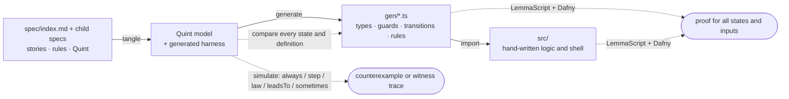
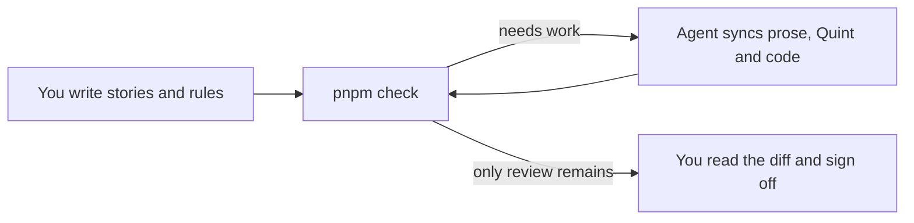

<div align="center">

# Vibestack

Write user stories and rules in Markdown with [Quint](https://quint-lang.org)
under each rule; get TypeScript that is simulated and proved with
[Dafny](https://dafny.org) to keep them.

[](https://github.com/lalalune/vibestack/generate)

[Quickstart](#quickstart) ·
[Getting started](#getting-started) ·
[Project setup](#set-up-a-new-project) ·
[Studio](#studio) ·
[Build your project](#build-your-project) ·
[Examples](#examples) ·
[Spec reference](AGENTS.md#spec-reference)

</div>

---

## Quickstart

**Starting a new project? Paste this into your agent:**

```text
Help me build a new project from https://github.com/lalalune/vibestack.

Start by asking what I want to build, who it is for, and its main workflows.
Then:
1. Use the template in a new project directory, or use my existing copy.
   Read AGENTS.md and README.md in full and follow their design and sync skills.
2. Check for Node.js 26+ and Dafny 4.11 on PATH, run pnpm install, and follow
   the README's "Set up a new project" section.
3. Write my stories and rules in spec/index.md, with Quint under each rule.
4. Build the app in src/ using the generated code in gen/. Add tests for
   user journeys through the UI, API, storage, or other external services.
5. Run pnpm check and fix failures until only my review remains.
   Never edit generated files or weaken rules to pass checks.
6. Show me how to run the app, summarize what needs review, and wait for
   my request before running pnpm accept.
```

[](https://chatgpt.com/?q=Help%20me%20build%20a%20new%20project%20from%20https%3A%2F%2Fgithub.com%2Flalalune%2Fvibestack-starter.%0A%0AStart%20by%20asking%20what%20I%20want%20to%20build%2C%20who%20it%20is%20for%2C%20and%20its%20main%20workflows.%0AThen%3A%0A1.%20Use%20the%20template%20in%20a%20new%20project%20directory%2C%20or%20use%20my%20existing%20copy.%0A%20%20%20Read%20AGENTS.md%20and%20README.md%20in%20full%20and%20follow%20their%20design%20and%20sync%20skills.%0A2.%20Check%20for%20Node.js%2026%2B%20and%20Dafny%204.11%20on%20PATH%2C%20run%20pnpm%20install%2C%20and%20follow%0A%20%20%20the%20README's%20%22Set%20up%20a%20new%20project%22%20section.%0A3.%20Write%20my%20stories%20and%20rules%20in%20spec%2Findex.md%2C%20with%20Quint%20under%20each%20rule.%0A4.%20Build%20the%20app%20in%20src%2F%20using%20the%20generated%20code%20in%20gen%2F.%20Add%20tests%20for%0A%20%20%20user%20journeys%20through%20the%20UI%2C%20API%2C%20storage%2C%20or%20other%20external%20services.%0A5.%20Run%20pnpm%20check%20and%20fix%20failures%20until%20only%20my%20review%20remains.%0A%20%20%20Never%20edit%20generated%20files%20or%20weaken%20rules%20to%20pass%20checks.%0A6.%20Show%20me%20how%20to%20run%20the%20app%2C%20summarize%20what%20needs%20review%2C%20and%20wait%20for%0A%20%20%20my%20request%20before%20running%20pnpm%20accept.)
[](https://claude.ai/new?q=Help%20me%20build%20a%20new%20project%20from%20https%3A%2F%2Fgithub.com%2Flalalune%2Fvibestack-starter.%0A%0AStart%20by%20asking%20what%20I%20want%20to%20build%2C%20who%20it%20is%20for%2C%20and%20its%20main%20workflows.%0AThen%3A%0A1.%20Use%20the%20template%20in%20a%20new%20project%20directory%2C%20or%20use%20my%20existing%20copy.%0A%20%20%20Read%20AGENTS.md%20and%20README.md%20in%20full%20and%20follow%20their%20design%20and%20sync%20skills.%0A2.%20Check%20for%20Node.js%2026%2B%20and%20Dafny%204.11%20on%20PATH%2C%20run%20pnpm%20install%2C%20and%20follow%0A%20%20%20the%20README's%20%22Set%20up%20a%20new%20project%22%20section.%0A3.%20Write%20my%20stories%20and%20rules%20in%20spec%2Findex.md%2C%20with%20Quint%20under%20each%20rule.%0A4.%20Build%20the%20app%20in%20src%2F%20using%20the%20generated%20code%20in%20gen%2F.%20Add%20tests%20for%0A%20%20%20user%20journeys%20through%20the%20UI%2C%20API%2C%20storage%2C%20or%20other%20external%20services.%0A5.%20Run%20pnpm%20check%20and%20fix%20failures%20until%20only%20my%20review%20remains.%0A%20%20%20Never%20edit%20generated%20files%20or%20weaken%20rules%20to%20pass%20checks.%0A6.%20Show%20me%20how%20to%20run%20the%20app%2C%20summarize%20what%20needs%20review%2C%20and%20wait%20for%0A%20%20%20my%20request%20before%20running%20pnpm%20accept.)

## Why

Agents write code fast; reading all of it is the slow part. Vibestack moves
what you must read to the top: a short list of sentences a product owner
would call true or false, each with its formal meaning underneath. From
there:

- **Generated, not written.** Types, guards, transitions and rule checks in
  `gen/<name>.ts` come from the spec. Nobody edits them.
- **Simulated.** Thousands of random traces look for a reachable state that
  breaks a rule, or a fair run that never reaches what a
  [`leadsTo` rule](AGENTS.md#liveness) waits for, and report the shortest one.
- **Proved.** Dafny proves that every transition keeps every rule, for all
  states and all inputs, and that your hand-written logic meets its contract.
- **Reviewed.** Every rule that changed is shown with its sentence and its
  Quint side by side, and nothing is done until you sign off.



## Getting started

**Needs** Node 26, [pnpm](https://pnpm.io) and
[Dafny](https://github.com/dafny-lang/dafny/releases) 4.11 on the `PATH`.

**Built with** [VibeLang](https://github.com/smithersai/vibelang) on Effect
for everything that touches the outside world, and React with Vite, Tailwind
CSS v4 and shadcn/ui for everything a person sees
([the stack](AGENTS.md#the-stack)). A pnpm workspace with Turborepo holds your
applications and packages beside Studio; the examples stand alone.

1. Click **[Use this template](https://github.com/lalalune/vibestack/generate)**
   to create your own repository, then clone it and enter its directory.
2. Install the toolchain and open your project in Studio:

   ```bash
   pnpm install
   pnpm dev
   ```

3. In `spec/index.md`, say what the product is for. In `spec/app/index.md`,
   the requirements of the application in `apps/app`, add its first story:
   who it is for, what they need to do, and why. You can write it in Studio
   or edit the Markdown file directly.
4. Ask the coding agent to sync. It writes the rules and Quint, runs the
   checks, and reports what needs your review.
5. Build your application in `apps/app/src/`: its shell in VibeLang, its
   interface in React, both on the generated code in `apps/app/gen/`. Follow
   [Build your project](#build-your-project).

## Studio

```bash
pnpm dev                              # this project
pnpm dev vibestack/examples/order     # an example, or any directory with spec/
```

Studio opens in the browser and is where you build the application: you
shape the stories, an agent turns them into rules, Quint and code, and the
checks say where the project stands.

| You | Studio |
|---|---|
| Add, edit, delete or drag a story or rule; group rules under a heading without `Story:`; move one to another spec | Applies it to its outline, with undo (⌘Z). Reorder with Alt+↑/↓, or **Move to…** |
| Add a spec by its path, such as `billing/payments` | Creates `spec/billing/payments/index.md` and links it from its parent |
| **Publish** (⌘S) | Shows the diff, writes the Markdown, and records in `.studio/manifest.json` what was added, changed, moved or deleted and what to regenerate. Then runs the checks |
| **Run** beside Claude Code or Codex | Starts the agent on the sync prompt in the project and streams its progress; **Open** starts a new chat in the app with the same prompt |
| **Run check** | Shows each failing stage, and marks the story or rule it names |
| **Sign off** | Records the same approval as `pnpm accept` |

Studio is itself a Vibestack app in `vibestack/studio/`, built like any
other: its rules in `spec/`, its server in VibeLang (`src/server.vibe`) and
its page in React (`src/page/`). `pnpm dev` rebuilds the page when its
source changed. To work on Studio:

```bash
pnpm dev vibestack/studio                     # open Studio on its own spec
pnpm --filter vibestack-studio check          # its specs, proofs and journeys
pnpm --filter vibestack-studio test           # its journeys only, Playwright included
```

## Build your project

### 1. Write your requirements

A `##` heading is a story, a `###` heading is a rule, and a `quint` block
under a rule states its formal meaning. Write the prose; the agent can write
the rules and their Quint. The repository has one spec tree: `spec/index.md`
introduces the product and links to each area, and `spec/<name>/` holds the
requirements of the package `apps/<name>` or `packages/<name>`
([one spec tree](AGENTS.md#one-spec-tree)). `pnpm new <name>` writes
`spec/<name>/index.md` with a small scaffold to replace.

### 2. Sync and check

Ask the agent in your session to sync: it follows the
[`sync` skill](.claude/skills/sync/SKILL.md).



Each report ends with a `next:` line; the agent follows it until only your
review remains. CI runs the root check only.

### 3. Build on the generated code

`pnpm check`, at the root, generates your types, guards and transitions in
`gen/`, and those of `spec/app/` in `apps/app/gen/` as well. For a state
machine, import its Effect adapter into your shell:

```vibe
import { Machine, machine, apply, decodeEvent, decodeState } from "../gen/app.effect.vibe"
```

`Machine` holds the state and changes it only by an event the rules allow:
`receive(input)` decodes an untrusted value and applies it, failing with
`NotAnEvent` or `Rejected`. A shell that stores state builds its own service
on `apply`, and passes what it loads through `decodeState`. If the spec uses
a sender parameter named `by`, authenticate that sender in your shell and
pass it separately ([the VibeLang shell](AGENTS.md#the-vibelang-shell)).

Put HTTP, storage and other I/O in the package's `src/` as VibeLang, the interface as
React components that read the state and send events through hooks over
`Machine`, and whole-journey tests in `test/`. Keep pure logic in the spec
wherever Quint can express it. Logic that needs TypeScript, such as a loop,
carries [LemmaScript](https://github.com/midspiral/LemmaScript) contracts and
is proved too. When the spec changes, the `types` stage points at application
code that must follow. Never edit `gen/`.

### 4. Grow the spec by area

`pnpm new billing` creates `spec/billing/index.md`, linked from its
parent as `[Billing](./billing/)`. See the
[spec reference](AGENTS.md#writing-a-spec).

### 5. Review and sign off

When only `review` items remain, read the diff of `spec/`, `src/` and `test/`.
Check that each rule's sentence and Quint say the same thing, then run:

```bash
pnpm accept
```

`accept` checks afresh and records what `review` lists in `spec/lock.json`,
[all or nothing](AGENTS.md#review). Commit the ledger with the spec.

## Set up a new project

Before committing your application's starting point:

1. **Remove what you do not need.** Delete `vibestack/examples/`, the `demo`
   and `examples` scripts and the `examples` job in
   `.github/workflows/ci.yml`; start your application from `apps/app` and its
   requirements from `spec/app/index.md`. Update the package name, description and
   repository links for your project.
2. **Keep the toolchain guide with the toolchain.** Move this README to
   `vibestack/README.md`, update its relative links, and keep the template
   license in `vibestack/LICENSE` alongside the Vibestack code.
3. **Write your project's documentation.** Create a root `README.md` with
   the project's purpose and install, run and check commands. Set the root
   `LICENSE` to the project's chosen terms and copyright holder.
4. **Check and commit.** Run `pnpm install` and `pnpm check`, resolve their
   reports, and review and accept the spec. Commit the setup and reviewed
   ledger, then confirm `git status --short` is empty.

## Commands

`<dir>` is any project directory containing `spec/`; it defaults to the
current one. Installed as a package, use `pnpm exec spec <command> [<dir>]`.

| Command | Does |
|---|---|
| `pnpm dev [<dir>]` | Opens Studio |
| `pnpm check [<dir>] [--json]` | Checks spec, source and tests; ends with a `next:` line ([JSON shape](AGENTS.md#changing-the-tools)) |
| `pnpm quick` | Types, lint and tests of what changed |
| `pnpm verify` | Everything CI runs for `main`, in every package and example |
| `pnpm gen [<dir>]` | Generates `gen/` only |
| `node vibestack/spec.ts watch [<dir>]` | Rechecks when a spec, source file or test changes |
| `pnpm accept [<dir>]` | The user's sign-off: checks afresh and records what `review` lists, [all or nothing](AGENTS.md#review) |
| `pnpm accept unproved` | Records the listed obligations as simulated only. The user's decision |
| `pnpm new [<path>]` | Fills an empty root index or creates a child [starter spec](AGENTS.md#writing-a-spec) |
| `node vibestack/spec.ts migrate [<dir>]` | Consolidates old review ledgers into `spec/lock.json`, keeping their approvals; proof exceptions in the old list form are dropped and must be proved or accepted again |
| `node vibestack/spec.ts init [<dir>]` | Sets up an existing project; see [Using it from another package](AGENTS.md#using-it-from-another-package) |
| `pnpm demo` | Runs the order example's scripted checkout session |
| `pnpm selftest` | Breaks the pipeline one way at a time and checks each break is caught |
| `pnpm build` | Compiles the tools into `dist/`, the packaged `spec` command |

| Exit code | Means |
|---|---|
| 0 | green |
| 1 | a `✗`, or an error |
| 2 | bad arguments; prints the usage line |

## Examples

| Project | What it covers | Open in Studio |
|---|---|---|
| [Order checkout](vibestack/examples/order/README.md) | Guards, payments, cancellation and a proved event ledger | `pnpm dev vibestack/examples/order` |
| [Team dashboard](vibestack/examples/dashboard/README.md) | Shared spreadsheets, chat notifications and a project registry | `pnpm dev vibestack/examples/dashboard` |
| [Shared to-do list](vibestack/examples/fullstack/README.md) | HTTP server, browser client and two tabs over an unreliable network | `pnpm dev vibestack/examples/fullstack` |
| [Assistant](vibestack/examples/assistant/README.md) | Trusted senders, bounded turns, late replies, confirmation before payment and a secret card | `pnpm dev vibestack/examples/assistant` |

## Contributing

See [CONTRIBUTING.md](CONTRIBUTING.md).

## License

[MIT](LICENSE)
