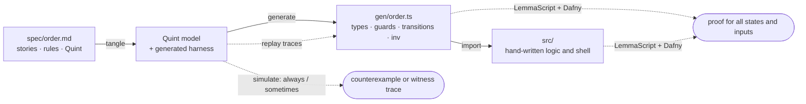

# One spec, proved software

A toy that turns user stories into working, formally verified TypeScript, with
one hand-written source of truth.

You write `spec/<name>.md`: stories, the rules each story implies, and under
every rule the few lines of [Quint](https://quint-lang.org) that say the same
thing exactly. Everything else is derived and checked:



The example is an order checkout (`spec/order.md`): fill a draft, submit, pay
in instalments, cancel, reopen, take items or money back out. From about 200
lines of Markdown the pipeline produces the
TypeScript domain module, proves that every transition preserves every rule,
and proves two hand-written functions against that contract.

## Run it

Needs Node 24+ and [Dafny](https://github.com/dafny-lang/dafny) 4+ on the path
(`brew install dafny`, or see Dafny's install page). `npm run sync` also needs
an agent: Claude Code (`claude`, signed in) if available, otherwise a local
Ollama model with no account at all (see CONTRIBUTING.md).

```sh
npm install        # also builds the `spec` command and generates gen/
npm run check      # the whole pipeline, about 15 seconds on a quiet machine
npm run sync       # check, let an agent translate whatever is out of step, repeat
npm run accept     # sign off the reconciled rules
npm run demo       # a scripted session against the verified core
npm run selftest   # breaks the example one way at a time and checks each break is caught
```

## The process

1. **Change any embodiment.** Add a story in prose, a rule in prose, or edit
   the Quint, in any order and as little as you like.
2. **`npm run sync`.** It runs the check and hands every failure to an agent
   with a brief: a story with no rules becomes rules, a rule with no Quint
   gets its Quint, a rule whose model moved gets its prose updated (and the
   reverse), and a counterexample trace or unprovable transition becomes a
   new rule marked as discovered. It repeats, for at most five rounds, until
   only your sign-off is left. `npm run check` on its own does the detecting
   without the translating, if you would rather translate by hand.
3. **Sign off.** Read the diff of `spec/`, then **`npm run accept`**. It
   records the rules as reconciled only if every other stage passes. `sync`
   never accepts on your behalf.
4. **Use the result.** The application imports `gen/<name>.ts`. When the
   contract changes, `tsc` points at every place the application must follow.

[AGENTS.md](AGENTS.md) is this loop as an operating procedure, including what
to do for each kind of failure. [CONTRIBUTING.md](CONTRIBUTING.md) is the
reference for writing specs and using the generated code.

## What `npm run check` checks

Stages run cheapest first. A broken model stops the later stages, because
their failures would only restate the first one.

| Stage | Question | How | Strength |
|---|---|---|---|
| `model` | Is the spec well-typed and inside the supported subset? | `quint typecheck`, `tools/gen.ts` | exact |
| `always` | Does any reachable state break an `always` rule? | `quint run` | 10,000 random traces; a failure comes with the trace |
| `sometimes` | Can each `sometimes` goal be reached at all? | `quint run` | a witness trace is a proof |
| `replay` | Does the generated TypeScript behave like the Quint model? | replays 50 of those traces and every witness | sampled |
| `types` | Does the application fit the generated contract? | `tsc` | exact |
| `proof` | Does every transition preserve every `always` and `step` rule, does every law hold, and does hand-written logic meet its `//@` contract? | LemmaScript, Dafny | all states, all inputs; what Dafny cannot prove alone is listed, and passes only once recorded in `spec/unproved.lock.json` |
| `tests` | Does the shell work? | `node --test` | examples |
| `review` | Does every story have rules, and has every rule whose prose or model changed been reconciled? | `spec/<name>.lock.json` | exact |

## What lives where

Keep `spec/`, `src/`, `test/` and `tools/` in git, including the lock file.
`gen/` is derived, ignored by git and rebuilt by every `check`; never edit it.

| Path | Role |
|---|---|
| `spec/order.md` | The source of truth: stories, rules, Quint |
| `spec/order.lock.json` | Review ledger written by `npm run accept` |
| `tools/spec.ts` | The pipeline: tangle, simulate, replay, prove, review, sync |
| `tools/gen.ts` | Quint → TypeScript and the simulation harness |
| `tools/agent-ollama.ts` | Optional agent for `sync` backed by a local model |
| `examples/alpha-energy/` | A real application modelled with the same tools, as a separate package |
| `tools/selftest.ts` | Mutation tests of the pipeline itself |
| `src/ledger.ts` | Hand-written logic, proved against the generated contract |
| `src/app.ts` | Unverified shell: storage, input validation, error reporting |

## A real application

`examples/alpha-energy` models a real 5,500-line project tracker (tasks in a
hand-editable Google Sheet, driven from Slack) in three specs: a library of
arithmetic with laws, the sheet itself with guarded app edits and unguarded
hand edits, and the registry of projects.

```sh
npm run check:alpha
```

24 transitions, 16 `always` and `step` rules, 11 laws. 86 obligations are
proved for all inputs and 85 are recorded as simulated only, because they
depend on folds over the warning list. Modelling cells as lists rather than
sets found a real bug in the application: a name typed twice in an owners
cell made the notifier message that person twice.

The toolchain is itself a package (`onespec`, command `spec`), and the example
depends on it like any other project would. CONTRIBUTING.md covers lists,
libraries, laws, step rules, the proof ledger and large applications.

## What is and is not guaranteed

Proved for all states and inputs: the initial state satisfies every `always`
rule, every transition preserves them, and hand-written `//@ ensures` hold,
except for obligations listed in `spec/unproved.lock.json`, which are
simulated only. The order example has none.

Trusted, not proved:

- **The prose.** Whether the Quint under a rule means what the sentence above
  it says is a judgement. The `review` stage makes sure someone made it.
- **`tools/gen.ts`.** Simulation checks the Quint model; the proof checks the
  TypeScript. `replay` ties the two together on sampled traces only, and only
  for events the model allows.
- **The shell** (`src/app.ts`), LemmaScript and Dafny. The proofs treat
  `number` as an integer; the generated `isEvent` rejects anything else at the
  boundary, and arithmetic is exact up to 2^53.
