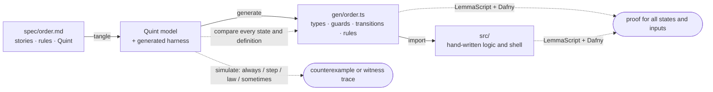

# One spec, proved software

Turn user stories into working, formally verified TypeScript, with one
hand-written source of truth.

You write `spec/<name>.md`: stories, the rules each story implies, and under
every rule the few lines of [Quint](https://quint-lang.org) that say the same
thing exactly. Everything else is derived and checked:



The example is an order checkout (`spec/order.md`): fill a draft, submit, pay
in instalments, hold, cancel, reopen. From about 250 lines of Markdown the
pipeline produces the TypeScript domain module, proves that each of its 10
transitions preserves every rule, and proves two hand-written functions
against that contract.

## Run it

Needs Node 24+ and [Dafny](https://github.com/dafny-lang/dafny) 4+ on the path
(`brew install dafny`, or see Dafny's install page).

```sh
npm install        # also builds the `spec` command and generates gen/
npm run check      # the whole pipeline; a few seconds when nothing changed
npm run accept     # sign off the reconciled rules
npm run demo       # a scripted session against the verified core
npm run selftest   # breaks things one at a time and checks each break is caught
npm run check:alpha   # the same pipeline on examples/alpha-energy
```

## The process

1. **Change any embodiment.** Add a story in prose, a rule in prose, or edit
   the Quint, in any order and as little as you like.
2. **The agent in your session syncs.** It follows the `sync` skill
   ([.claude/skills/sync/SKILL.md](.claude/skills/sync/SKILL.md), linked from
   [AGENTS.md](AGENTS.md)): it runs `npm run check`, which reports what is out
   of step, and makes each translation. A story with no rules becomes rules.
   A rule with no Quint gets its Quint. A rule whose model moved gets its
   prose updated, and the reverse. A counterexample trace or an unprovable
   transition becomes a new rule, marked as discovered. It repeats until only
   your sign-off is left. No other program or account is involved.
3. **Sign off.** Read the diff of `spec/` and what the agent reports, then
   **`npm run accept`**. It checks everything afresh and records the rules as
   reconciled only if every other stage passes. The agent never accepts on
   your behalf.
4. **Use the result.** The application imports `gen/<name>.ts`. When the
   contract changes, `tsc` points at every place the application must follow.

[CONTRIBUTING.md](CONTRIBUTING.md) is the reference for writing specs and
using the generated code.

## What `npm run check` checks

Stages run cheapest first. A broken model stops the later stages, because
their failures would only restate the first one.

| Stage | Question | Strength |
|---|---|---|
| `model` | Is the spec well-typed and inside the supported subset? | exact; anything unsupported is refused by name |
| `always` | Does a reachable state break an `always` rule, a step break a `step` rule, or a sampled argument break a law? | 10,000 random traces; a failure comes with the shortest trace |
| `sometimes` | Can each `sometimes` goal be reached at all? | a witness trace is a proof |
| `replay` | Does the generated TypeScript mean what the Quint means? | 400 sampled traces: every state, every law tried, and the result of every definition the simulator can evaluate. Definitions it cannot evaluate are listed |
| `types` | Does the application fit the generated contract? | exact |
| `proof` | Does every transition preserve every `always` and `step` rule, does every law hold, and does hand-written logic meet its `//@` contract? | all states, all inputs. What Dafny cannot prove alone is listed, and passes only once recorded in `spec/unproved.lock.json` |
| `tests` | Does the shell work? | examples |
| `review` | Does every story have rules, and has every rule whose prose or model changed been reconciled? | exact |

## What lives where

Keep `spec/`, `src/`, `test/` and `tools/` in git, lock files included.
`gen/` and `.spec-cache/` are derived and ignored by git; never edit them.

| Path | Role |
|---|---|
| `spec/order.md` | The source of truth: stories, rules, Quint |
| `spec/order.lock.json` | Review ledger written by `npm run accept` |
| `spec/unproved.lock.json` | Obligations accepted as simulated only, written by `npm run accept -- unproved`. Absent when there are none |
| `.claude/skills/sync/SKILL.md` | How the agent in your session keeps stories, rules and model in step |
| `tools/spec.ts` | The pipeline: tangle, simulate, compare, prove, review |
| `tools/gen.ts`, `tools/gen/` | Quint → TypeScript and the simulation harness: types, expressions, classification, and the two outputs, one file each |
| `tools/selftest.ts`, `tools/fixtures/` | Tests of the pipeline itself, and the small specs they use |
| `src/ledger.ts` | Hand-written logic, proved against the generated contract |
| `src/app.ts` | Unverified shell: storage, input parsing, error reporting |
| `examples/alpha-energy/` | A real application modelled with the same tools, as a separate package |

## A real application

`examples/alpha-energy` models a real 5,500-line project tracker (tasks in a
hand-editable Google Sheet, driven from Slack) in three specs: a library of
arithmetic with laws, the sheet itself with guarded app edits and unguarded
hand edits, and the registry of projects. It has 24 transitions, 15 `always`
and `step` rules and 11 laws.

Everything holds in simulation, and the TypeScript agrees with Quint on all
102 definitions the simulator can evaluate. Of 272 proof obligations, 191 are
proved for all inputs. The other 81 hold in simulation but Dafny cannot prove
them alone, because they depend on folds over the warning list. The owner
judged simulation enough for them and recorded them, so they are listed in
the example's `spec/unproved.lock.json` and its check is green. If a change
makes one of them provable, the check says so.

Modelling cells as lists rather than sets found a real bug in the
application: a name typed twice in an owners cell made the notifier message
that person twice. The one-line fix, with a test, is in the example as a
patch and has been applied to the application.

## What is and is not guaranteed

Proved for all states and inputs: the initial state satisfies every `always`
rule, every transition preserves every `always` and `step` rule, every law
holds, and hand-written `//@ ensures` hold, except for obligations listed in
`spec/unproved.lock.json`. The order example has none.

Trusted, not proved:

- **The prose.** Whether the Quint under a rule means what the sentence above
  it says is a judgement. The `review` stage makes sure someone made it.
- **The generator** (`tools/gen.ts`, `tools/gen/`). Simulation checks the Quint model; the proof checks the
  TypeScript. `replay` ties the two together on sampled traces only.
- **The shell** (`src/app.ts`), LemmaScript, Dafny and Quint.
- **Numbers.** The proofs treat `number` as an unbounded integer. The
  generated `parseEvent` admits only safe integers, but nothing stops sums of
  them from passing 2^53, where JavaScript arithmetic is no longer exact.
- **The working directory.** Anyone who can edit `gen/`, `.spec-cache/` or the
  tools can make `check` say what they like. `accept` ignores the cache, and
  continuous integration should run with `SPEC_NO_CACHE=1`.
