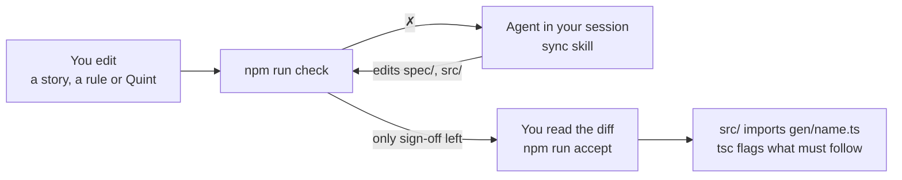

<div align="center">

# Vibespec (Starter Template)

**Write user stories. Get formally verified TypeScript.**

A Markdown spec tree starts at `spec/index.md` and holds the stories, the
rules each story implies, and under every rule a few lines of
[Quint](https://quint-lang.org) that say it exactly. Link to child specs to
keep each area small. Everything else is generated, simulated and proved with
[Dafny](https://dafny.org). The coding agent in your session keeps prose and
model in step; you sign off.

[](https://github.com/lalalune/vibespec-starter/generate)

[](https://github.com/lalalune/vibespec-starter/actions/workflows/check.yml)

[Quick start](#quick-start) ·
[Examples](#run-and-test-examples) ·
[Project setup](#set-up-a-new-project) ·
[Tutorial](#tutorial) ·
[How it works](#what-npm-run-check-checks) ·
[Guarantees](#what-is-and-is-not-guaranteed) ·
[Spec reference](AGENTS.md#spec-reference)

</div>

---

## Why

Agents write code fast; reading all of it is the slow part. Vibespec moves
what you must read to the top: a short list of sentences a product owner
would call true or false, each with its formal meaning underneath. From
there:

- **Generated, not written.** Types, guards, transitions and rule checks in
  `gen/<name>.ts` come from the spec. Nobody edits them.
- **Simulated.** Thousands of random traces look for a reachable state that
  breaks a rule, and report the shortest one.
- **Proved.** Dafny proves that every transition keeps every rule, for all
  states and all inputs, and that your hand-written logic meets its contract.
- **Reviewed.** Every rule that changed is shown with its sentence and its
  Quint side by side, and nothing is done until you sign off.


The [order example](vibespec/examples/order/README.md) is a checkout
(`vibespec/examples/order/spec/index.md`, about 250 lines): fill a draft, submit, pay
in instalments, hold, cancel, reopen. The template's own `spec/index.md` is
blank.

| Order example | |
|---|---|
| Model | 10 transitions, 6 `always`, 1 `step`, 3 `sometimes` rules |
| Proved, spec | 72 obligations, all states and inputs |
| Proved, `vibespec/examples/order/src/ledger.ts` | 2 hand-written functions, 3 obligations |

## Quick start

**Needs** Node 24+ and [Dafny](https://github.com/dafny-lang/dafny/releases)
4.11 on the `PATH`. Packages with `src/` or `test/` also need a
`tsconfig.json` so the generated contract is checked against the application.

1. Click **[Use this template](https://github.com/lalalune/vibespec-starter/generate)**
   to create your own repository, then clone it.
2. Install and check the template:

```bash
npm install
```

```bash
npm run check
```

```bash
npm run demo
```

`npm install` builds the `spec` command and generates `gen/` when every spec
is valid. `npm run check` checks the current project and ends with a `next:` line.
Run `npm run check --workspaces --if-present` to check every example.
`npm run demo` generates and runs `vibespec/examples/order`, driving the verified checkout
through a scripted session; every `✗` is a rule refusing an event:

```
✗ {"type":"submit"}              submit is not allowed for a Draft order
✓ {"type":"addItem","qty":2}     {"status":"Draft","units":2,"due":10,"paid":0}
✓ {"type":"submit"}              {"status":"Pending","units":2,"due":10,"paid":0}
✓ {"type":"pay","amount":4}      {"status":"Pending","units":2,"due":10,"paid":4}
✗ {"type":"pay","amount":7}      pay is not allowed for a Pending order
✓ {"type":"pay","amount":6}      {"status":"Paid","units":2,"due":10,"paid":10}
✗ {"type":"cancel"}              cancel is not allowed for a Paid order
balance 0
```

## Run and test examples

Run these commands from the repository root after `npm install`. Pass the
project directory, which contains `spec/` and `package.json`, rather than the
path to an individual Markdown spec.

```bash
npm run check -- vibespec/examples/order
npm run gen -- vibespec/examples/order
npm --prefix vibespec/examples/order run demo
```

`check` runs the selected project's models, simulation, proofs, typechecking
and tests. `gen` only rebuilds its generated code. Output and caches stay in
that project; the root's blank `spec/index.md` is unchanged. Relative paths,
quoted paths containing spaces and absolute paths all work.

| Example directory | What to run |
|---|---|
| `vibespec/examples/order` | The checkout demo above |
| `vibespec/examples/dashboard` | `npm run check -- vibespec/examples/dashboard` for the task model and notification tests |
| `vibespec/examples/assistant` | `npm run check -- vibespec/examples/assistant` for the trusted-sender and payment model |
| `vibespec/examples/fullstack` | Check it, then start the shared to-do app as shown below |

```bash
npm run check -- vibespec/examples/fullstack
npm --prefix vibespec/examples/fullstack run start
```

Open [http://localhost:3000](http://localhost:3000) in two browser windows to
try the shared list.

To check every bundled example, use the workspace command:

```bash
npm run check --workspaces --if-present
```

The same directory argument works with `npm run accept -- <directory>`
when you are ready to sign off on that project's reviews. To recheck while
editing, run `npx spec watch <directory>`; stop it with Ctrl-C. Omitting the
directory keeps each command on the current project.

## Set up a new project

This repository keeps its examples so people can try the template. When you
use it for a new project, finish this cleanup before feature work:

1. **Remove the examples.** Delete `vibespec/examples/`, including the order
   example. Remove their workspace entries, npm scripts and CI steps, such
   as `demo` and `check:dashboard`, and replace the package metadata and
   repository links with the new project's.
2. **Keep the toolchain guide with the toolchain.** Move this README to
   `vibespec/README.md` (the toolchain directory formerly called `tools/`).
   Update its relative links and the guide references in `AGENTS.md` and the
   skills. Keep the original template license in `vibespec/LICENSE` alongside
   the retained Vibespec code.
3. **Write the project's own files.** Create a new root `README.md` describing
   what the project does and how to install, run and check it. Rewrite the root
   `LICENSE` for the project's chosen terms and copyright holder. Add the
   project's initial stories and rules under `spec/`.
4. **Check and sign off.** Run `npm install` and `npm run check`, resolve what
   they report, and have the project owner review and accept the new spec with
   `npm run accept`.
5. **Commit the starting point.** Commit all setup changes, including the
   deletions and reviewed spec ledgers, then confirm the working tree is clean:

   ```bash
   git add -A
   git commit -m "Initialize project"
   git status --short
   ```

An empty status means the project is ready for its first feature.

## Studio

`npm run dev` opens Studio on the root project. To open an example immediately,
pass its short name or its directory. To work on another application, pass
that application's directory instead:

```bash
npm run dev
npm run dev -- order
npm run dev -- vibespec/examples/order
npm run dev -- ../my-app --port 4310
```

Absolute directories and quoted paths containing spaces work too. Pass the
project folder, not its `spec/` folder or `spec/index.md`. With no argument,
Studio still opens the root project and offers the bundled examples in its
project selector. A supplied folder is selected when Studio opens.

Edit stories and rules, then publish. Studio records the changes, runs checks,
and can hand the sync work to Claude Code or Codex. Sign-off uses the same
`accept` command as the terminal. `npx spec watch <directory>` provides the
same rechecking loop without Studio.

## Tutorial

### 1. Read a spec

In [the order spec](vibespec/examples/order/spec/index.md), `##` is a story, `###` a
rule, and the `quint` block under a rule is its formal half.

````markdown
## Story: Check out

> As a shopper, I want to submit my order and pay it off in one or more
> payments, so that I do not need the whole amount at once.

### A payment never exceeds the balance

A payment is a positive amount toward a pending order. The payment that
clears the balance marks the order as paid.

```quint
pure def canPay(o: Order, amount: int): bool =
  o.status == Pending and amount > 0 and o.paid + amount <= o.due

pure def pay(o: Order, amount: int): Order =
  val paid = o.paid + amount
  { ...o, paid: paid, status: if (paid == o.due) Paid else Pending }
```

### A pending order still has a balance

```quint
pure def alwaysPendingHasBalance(o: Order): bool =
  o.status == Pending implies o.paid < o.due
```
````

There is no state machine to write. A definition's name and signature give
its role ([all of them](AGENTS.md#what-goes-in-the-quint-blocks)):

| You write | It is |
|---|---|
| `pure val initial: Order` | the initial state; its type is the state type |
| `pure def pay(o: Order, …): Order` | a transition, and an event `{ type: "pay", amount }` |
| `pure def canPay(o: Order, …): bool` | the guard of `pay` |
| `pure def alwaysX(o: Order): bool` | holds in every reachable state |
| `pure def stepX(before: Order, after: Order): bool` | holds across every transition |
| `pure def sometimesX(o: Order): bool` | some reachable state has it |
| `pure def leadsToX(o: Order, later: Order): bool` | every fair run from `o` reaches such a `later` |
| `pure def lawX(…): bool` | true for every argument |

The example's `gen/index.ts` gets the same definitions in TypeScript. Each
transition carries one obligation per rule, which Dafny proves:

```ts
/** Story: Check out / A payment never exceeds the balance (spec/index.md:73) */
//@ pure
export function pay(o: Order, amount: number): Order {
  //@ ensures (inv(o) && canPay(o, amount)) ==> alwaysPendingHasBalance(\result)
  //@ ensures (inv(o) && canPay(o, amount)) ==> stepNothingIsPaidOnHold(o, \result)
  // … one per always and step rule
  const paid = o.paid + amount;
  return { ...o, paid: paid, status: paid === o.due ? "Paid" : "Pending" };
}

export function parseEvent(x: unknown): Event | undefined  // untrusted input → event, or not
export function enabled(current: Order, event: Event): boolean
export function step(current: Order, event: Event): Order
export function inv(current: Order): boolean               // every always rule at once
```

### 2. Start your own application

```bash
npm run new
```

This fills the blank `spec/index.md` with a
[starter spec](AGENTS.md#writing-a-spec) that passes every stage but `review`:
one story, a state, one guarded transition, an `always` and a `sometimes`
rule. Replace its story with yours. The order app remains in `vibespec/examples/order/`.

As the application grows, `npm run new -- billing` creates
`spec/billing/index.md`, and `npm run new -- billing/payments` creates
`spec/billing/payments/index.md`. Once those areas exist, link from an index
to its child specs:

```markdown
# Application

[Billing](./billing/)
```

Directory links resolve to `index.md`. `check` discovers every Markdown spec
recursively, including children; links organize navigation, while Quint
imports share definitions. For example, a billing spec can write
`import currency.* from "../shared/currency"` under a rule. The generated
module names reflect paths: `spec/index.md` → `gen/index.ts`,
`spec/billing/index.md` → `gen/billing.ts`, and
`spec/billing/payments/index.md` → `gen/billing__payments.ts`.
All paths stay inside `spec/`; see the [spec reference](AGENTS.md#writing-a-spec).

For a repository created from the template, follow [project setup](#set-up-a-new-project)
to remove the examples and establish the project's own documentation and license.

### 3. Write a story; let the agent write the rules

Add a story in prose only:

```markdown
## Story: Start again

> As a user, I want to reset my tally to zero, so that I can count again.
```

Then ask the agent in your session (Claude Code, or any agent that reads
[AGENTS.md](AGENTS.md)) to sync. It follows the
[`sync` skill](.claude/skills/sync/SKILL.md):



Each kind of report asks for one translation:

| `npm run check` reports | The agent writes |
|---|---|
| story has no rules | rules, then their Quint |
| not formalized | Quint that says what the sentence says, and no more |
| prose changed | Quint, if the meaning moved |
| model changed | the sentence, to match the Quint |
| a trace breaks a rule | the missing reason, as a new rule |
| not proved | a proof, or the missing fact as a new rule |

For the story above it might write:

````markdown
### A tally that has counted something can be reset to zero

```quint
pure def canReset(t: Tally): bool = t.count > 0
pure def reset(t: Tally): Tally = { count: 0 }
```
````

It then stops and reports the rules it added, the rules the checks forced,
and anything it could not formalize or prove. It runs `npm run accept` only
when you ask.

### 4. When simulation finds a missing rule

Weaken `canSubmit` in the order example to `o.status == Draft`, and the
`always` stage finds the shortest trace to a broken rule:

```
✗ always    spec/index.md: a reachable state breaks "Story: Check out /
            A pending order still has a balance" (spec/index.md:93)
      initial                        -> {"status":"Draft","units":0,"due":0,"paid":0}
      {"type":"submit"}              -> {"status":"Pending","units":0,"due":0,"paid":0}
      last event: "Story: Check out / Only a non-empty draft can be submitted" (spec/index.md:63); its guard canSubmit let it through
      fallback: refuse submit when its result would break alwaysPendingHasBalance
      seed …; to simulate again: npx quint run gen/index.run.qnt …
```

The fix is the *reason*, written as a rule in the user's words. Rules found
this way say so: see "No more can be removed than the order holds" in
[the order spec](vibespec/examples/order/spec/index.md).

### 5. When a proof fails

A rule can hold on every trace and still not be provable, because the proof
starts from *any* state that satisfies the rules, reachable or not. Delete
"Drafts and cancelled orders hold no money" from the order example: every
trace still passes, but Dafny now considers a draft that is already paid,
and `submit` can no longer be proved to leave a balance.

[Three ways out](AGENTS.md#when-a-proof-does-not-go-through). First
decide whether the obligation holds in every state that satisfies the rules.
If you can name one where it does not, as with the paid draft here, no proof
can help.

1. **Prove it**, if it holds, in `spec/<path>.proof.dfy`, with Dafny lemmas
   only. The tools refuse anything that would assume rather than prove.
2. **State the missing fact** as a new `always` rule, if it does not. "An
   order on hold still has a balance" in the order example was found this way.
3. **Accept it as simulated only**, with `npm run accept -- unproved`, for a
   spec only: hand-written code must be proved. Your decision, never the
   agent's, and it lapses when the spec or its proof file changes.

### 6. Build on the generated code

Application code goes through `parseEvent`, `enabled` and `step`, as
[the order shell](vibespec/examples/order/src/app.ts) does:

```ts
dispatch(id: string, input: unknown): Order {
  const event = parseEvent(input);
  if (!event) throw new Rejected("not a well-formed event");
  const order = this.get(id);
  if (!enabled(order, event)) throw new Rejected(`${event.type} is not allowed …`);
  …
}
```

Logic Quint cannot express, such as a loop over an event log, is written in
TypeScript with [LemmaScript](https://github.com/midspiral/LemmaScript)
contracts and proved too. From [the order ledger](vibespec/examples/order/src/ledger.ts):

```ts
export function replay(events: Event[]): Order {
  //@ ensures inv(\result)
  …
}
```

When the spec changes, `tsc` points at every line of `src/` that must follow.

### 7. Sign off

When only `review` items are left, read the diff of `spec/`, `src/` and `test/`, and
check that each rule's sentence and its Quint say the same thing. Then:

```bash
npm run accept
```

`accept` checks afresh and records what `review` lists in `spec/lock.json`,
[all or nothing](AGENTS.md#review). Commit them with the spec.

## Commands

| Command | Does |
|---|---|
| `npm run dev -- <example-or-directory>` | Opens Studio on that project; omit the argument for the root |
| `npm run check -- <directory>` | Every stage below for that project; omit the directory for the current project |
| `npx spec check <directory> --json` | That project's check as one JSON object ([shape](AGENTS.md#changing-the-tools)) |
| `npm run gen -- <directory>` | Generates that project's `gen/` only |
| `npx spec watch <directory>` | Rechecks that project when its spec, source or tests change |
| `npm run accept -- <directory>` | The user's sign-off: checks afresh and records what `review` lists, [all or nothing](AGENTS.md#review) |
| `npm run accept -- unproved` | Records the listed obligations as simulated only. The user's decision |
| `npm run new` / `npm run new -- <path>` | Fills an empty root index or creates a child [starter spec](AGENTS.md#writing-a-spec) |
| `npx spec migrate <directory>` | Consolidates that project's old review ledgers into `spec/lock.json`, preserving their recorded approvals |
| `npm run demo` | A scripted session against the verified core |
| `npm run check:dashboard` | `check` on `vibespec/examples/dashboard` |
| `npm run selftest` | Breaks the pipeline one way at a time and checks each break is caught |
| `npm run build` | Compiles the tools into `dist/`, the packaged `spec` command |
| `npx spec init <directory>` | Sets up an existing project folder; see [Using it from another package](AGENTS.md#using-it-from-another-package) |

| Exit code | Means |
|---|---|
| 0 | green |
| 1 | a `✗`, or an error |
| 2 | bad arguments; prints the usage line |

## What `npm run check` checks

Stages run cheapest first. `✓` passed, `✗` failed, `-` skipped: blocked by a
`✗` above, or (`types`) there is no `tsconfig.json` and no source or tests to typecheck.

| Stage | Question | Strength |
|---|---|---|
| `model` | Is the spec well-typed and inside the supported subset? | exact; anything unsupported is refused by name |
| `always` | Does a reachable state break an `always` rule, a step break a `step` rule, a sampled argument break a law, or a fair run that stops or loops break a [`leadsTo` rule](AGENTS.md#liveness)? | 10,000 random traces; a failure comes with the shortest trace and its seed |
| `sometimes` | Can each `sometimes` goal be reached? Does each guard allow its event in some reachable state? | a witness trace is a proof; a failure means searches of 20, 40 and 100 events found none (200,000 traces at depth 20, with proportionally fewer at larger depths). [Guards never seen to refuse](AGENTS.md#writing-good-rules) are listed, not failed |
| `replay` | Does the generated TypeScript mean what the Quint means? | 400 sampled traces and every witness: every state, every law, and every definition the simulator can evaluate. The rest are listed |
| `types` | Does the application fit the generated contract? | exact |
| `proof` | Does every transition preserve every `always` and `step` rule, does every law hold, and does hand-written logic meet its `//@` contract? | all states, all inputs, counted per obligation under a fixed resource limit. What Dafny cannot prove alone is proved in a proof file (`spec/<path>.proof.dfy`: lemmas only, checked to add nothing but proof), or listed; a listed obligation passes only once the user records it in `spec/lock.json` under `unproved`, for that text of the unit |
| `tests` | Does the shell work with the real services around it? | whole user journeys, where the checks above cannot see ([AGENTS.md](AGENTS.md#tests)) |
| `review` | Does every story have rules and every rule Quint? Has every new or changed story, rule and `//@` contract been reconciled? | exact |

## What lives where

Keep `spec/`, `src/`, `test/` and `vibespec/` in git, lock files included.
`gen/`, `dist/` and `.spec-cache/` are derived and ignored by git; never edit them.

| Path | Role |
|---|---|
| `spec/index.md`, `spec/**/index.md`, `spec/**/*.md` | The spec tree: stories, rules, Quint and links; the template root is blank |
| `spec/lock.json` | Versioned review ledger: `specs` by source path, `contracts` by source file, and `unproved` by proof unit |
| `spec/<path>.proof.dfy`, `src/<path>.proof.dfy` | Proofs, in Dafny lemmas, of obligations Dafny cannot prove alone. Written by the agent; optional |
| `.spec-cache/` | Remembered results, and `lock`: one check or accept per project at a time |
| `.claude/skills/sync/SKILL.md` | How the agent in your session keeps stories, rules and model in step |
| `.claude/skills/design/SKILL.md` | How the agent designs what a person sees: only what the spec asks, visual first, few words |
| `vibespec/spec.ts` | The pipeline and command line |
| `vibespec/parse.ts`, `vibespec/review.ts` | Literate specs and review ledgers |
| `vibespec/cache.ts`, `vibespec/run.ts` | Stage caches and bounded tool execution |
| `vibespec/units.ts`, `vibespec/simulate.ts`, `vibespec/util.ts` | Generation, proof units, simulation, replay and shell tests |
| `vibespec/prove.ts`, `vibespec/proof/lib.dfy` | The proof stage for one unit, with the checks on proof files, and the library of general lemmas proof files call |
| `vibespec/gen.ts`, `vibespec/gen/` | Quint → TypeScript and the simulation harness |
| `vibespec/selftest.ts`, `vibespec/fixtures/` | Tests of the pipeline itself, and the small specs they use |
| `vibespec/examples/order/src/ledger.ts` | Hand-written logic, proved against the generated contract |
| `vibespec/examples/order/src/app.ts`, `vibespec/examples/order/src/demo.ts` | Unverified shell: storage, input parsing, error reporting; and the demo |
| `vibespec/examples/order/test/app.test.ts` | Tests of the shell, run by the `tests` stage |
| `vibespec/examples/order/` | Complete checkout example, with its own spec, shell and tests |
| `vibespec/examples/dashboard/` | A larger, synthesized example, as a separate package |
| `.github/workflows/check.yml` | Continuous integration: `npm run check` without the cache |
| **Derived** (not in git) | |
| `gen/<name>.ts`, `gen/<name>.qnt` | Generated TypeScript, and the tangled Quint model |
| `gen/<name>.run.qnt` | The simulation harness that `npx quint run` and `quint verify` take |
| `gen/traces/`, `gen/proof/` | The last simulated traces; the final Dafny and logs of each proof unit |
| `dist/` | The built `spec` command, from `npm run build` |

## A larger example

`vibespec/examples/dashboard` is a synthesized team task dashboard with made-up names
and data: tasks live in a shared spreadsheet that people also edit by hand, a
chat app carries commands and notifications, and a web page shows the state.

| Spec | Models | Rules | Proved |
|---|---|---|---|
| `kernel.md` | Arithmetic library | 10 laws | 10 obligations |
| `tracker.md` | One project's sheet: guarded dashboard edits, unguarded hand edits | 20 transitions; 10 `always`, 4 `step`, 4 `sometimes` | 282 obligations |
| `projects.md` | The registry of projects | 4 transitions; 2 `always`, 1 `step`, 1 `sometimes`, 1 law | 15 obligations |
| `src/columns.ts` | Hand-written logic | `//@` contracts | 4 obligations |

Every obligation is proved for all states and inputs.

Modelling an owners cell as a list, not a set, exposed a case a set cannot
express: a name typed twice. The rule "A person named twice in a cell is told
once" covers it, and `src/notify.ts` sends each person one message.

Two more examples exercise different boundaries:

- [Shared to-do list](vibespec/examples/fullstack/README.md): an HTTP server, browser
  client and a model of two tabs exchanging messages over an unreliable network.
- [Assistant](vibespec/examples/assistant/README.md): trusted senders, a bounded agent
  turn, late replies and a bill payment that requires the person's confirmation.

## What is and is not guaranteed

Proved for all states and inputs: the initial state satisfies every `always`
rule, every transition preserves every `always` and `step` rule, every law
holds, and hand-written `//@ ensures` hold, except for obligations listed in
`spec/lock.json` under `unproved` (spec units only; hand-written code must be proved)
and those resting on them, which every proof line lists. The order example has
none. Proof files add only lemmas, and those are proved too
([what they may use](AGENTS.md#proof-files)).

Trusted, not proved:

- **The prose.** Whether the Quint under a rule means what the sentence above
  it says is a judgement. The `review` stage makes sure someone made it.
- **The generator** (`vibespec/gen.ts`, `vibespec/gen/`). Simulation checks the Quint model; the proof checks the
  TypeScript. `replay` ties the two together on sampled traces only.
- **The shell** (`vibespec/examples/order/src/app.ts`), LemmaScript, Dafny and Quint.
- **Built-ins.** The proofs assume that built-ins such as `Math` and
  `Array.prototype` are not modified at run time, anywhere in the process.
- **Preconditions.** A `//@ requires` that can never hold makes a contract
  vacuous: everything after it is proved. That is why contracts are reviewed,
  through `spec/lock.json` under `contracts`.
- **Numbers.** The proofs treat `number` as an unbounded integer. The
  generated `parseEvent` admits only safe integers, but nothing stops sums of
  them from passing 2^53, where JavaScript arithmetic is no longer exact.
- **The working directory.** Anyone who can edit `gen/`, `.spec-cache/` or the
  tools can make `check` say what they like. `accept` ignores the cache, and
  continuous integration starts without `.spec-cache/`, which is not in git.

## FAQ

**Do I need to know Quint or Dafny?** To read a spec, a little Quint: it
reads like typed functional pseudocode, and each block sits under the
sentence it formalizes. Dafny you rarely see; when a proof needs help, the
agent writes the lemmas.

**What can a spec express?** Records, variants, lists, sets, maps, integers,
strings and booleans, with folds instead of loops. Anything outside the
subset is refused by name ([supported Quint](AGENTS.md#supported-quint)).

**What about I/O, HTTP and storage?** That is the shell, written by hand
around the generated core and covered by tests.

**Which agent?** Claude Code loads the skills in `.claude/skills/` directly.
Any other agent reads [AGENTS.md](AGENTS.md).

**Can I check harder than simulation?** Yes: run the Apalache model checker
on the generated harness, exhaustively up to a depth
([checking harder](AGENTS.md#checking-harder)).

## Contributing

How the repository works, the spec format, proof files and how to change the
tools are in [AGENTS.md](AGENTS.md); every agent reads it and this README in
full before doing any work. A change to `vibespec/` needs
`npm run selftest` to pass, with a new case for each new kind of mistake it
catches.

## License

[MIT](LICENSE)
