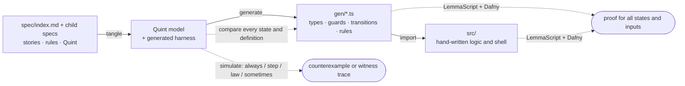
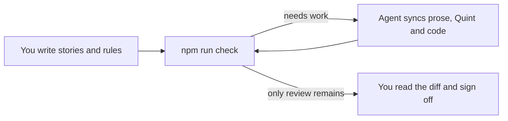

<div align="center">

# Vibespec (Starter Template)

**Write user stories. Get formally verified TypeScript.**

</div>

<div align="center">

A Markdown spec tree starts at `spec/index.md` and holds the stories, the
rules each story implies, and under every rule a few lines of
[Quint](https://quint-lang.org) that say it exactly. Link to child specs to
keep each area small. Everything else is generated, simulated and proved with
[Dafny](https://dafny.org). The coding agent in your session keeps prose and
model in step; you sign off.

[](https://github.com/lalalune/vibespec-starter/generate)

[](https://github.com/lalalune/vibespec-starter/actions/workflows/check.yml)

[Quickstart](#quickstart) ·
[Getting started](#getting-started) ·
[Project setup](#set-up-a-new-project) ·
[Studio](#studio) ·
[Build your project](#build-your-project) ·
[Examples](#examples) ·
[Spec reference](AGENTS.md#spec-reference)

</div>

---

## Quickstart

**Starting a new project? Paste this into your agent:**

```text
Help me build a new project from https://github.com/lalalune/vibespec-starter.

Start by asking what I want to build, who it is for, and its main workflows.
Then:
1. Use the template in a new project directory, or use my existing copy.
   Read AGENTS.md and README.md in full and follow their design and sync skills.
2. Check for Node.js 24+ and Dafny 4.11 on PATH, run npm install, and follow
   the README's "Set up a new project" section.
3. Write my stories and rules in spec/index.md, with Quint under each rule.
4. Build the app in src/ using the generated code in gen/. Add tests for
   user journeys through the UI, API, storage, or other external services.
5. Run npm run check and fix failures until only my review remains.
   Never edit generated files or weaken rules to pass checks.
6. Show me how to run the app, summarize what needs review, and wait for
   my request before running npm run accept.
```

[](https://chatgpt.com/?q=Help%20me%20build%20a%20new%20project%20from%20https%3A%2F%2Fgithub.com%2Flalalune%2Fvibespec-starter.%0A%0AStart%20by%20asking%20what%20I%20want%20to%20build%2C%20who%20it%20is%20for%2C%20and%20its%20main%20workflows.%0AThen%3A%0A1.%20Use%20the%20template%20in%20a%20new%20project%20directory%2C%20or%20use%20my%20existing%20copy.%0A%20%20%20Read%20AGENTS.md%20and%20README.md%20in%20full%20and%20follow%20their%20design%20and%20sync%20skills.%0A2.%20Check%20for%20Node.js%2024%2B%20and%20Dafny%204.11%20on%20PATH%2C%20run%20npm%20install%2C%20and%20follow%0A%20%20%20the%20README's%20%22Set%20up%20a%20new%20project%22%20section.%0A3.%20Write%20my%20stories%20and%20rules%20in%20spec%2Findex.md%2C%20with%20Quint%20under%20each%20rule.%0A4.%20Build%20the%20app%20in%20src%2F%20using%20the%20generated%20code%20in%20gen%2F.%20Add%20tests%20for%0A%20%20%20user%20journeys%20through%20the%20UI%2C%20API%2C%20storage%2C%20or%20other%20external%20services.%0A5.%20Run%20npm%20run%20check%20and%20fix%20failures%20until%20only%20my%20review%20remains.%0A%20%20%20Never%20edit%20generated%20files%20or%20weaken%20rules%20to%20pass%20checks.%0A6.%20Show%20me%20how%20to%20run%20the%20app%2C%20summarize%20what%20needs%20review%2C%20and%20wait%20for%0A%20%20%20my%20request%20before%20running%20npm%20run%20accept.)
[](https://claude.ai/new?q=Help%20me%20build%20a%20new%20project%20from%20https%3A%2F%2Fgithub.com%2Flalalune%2Fvibespec-starter.%0A%0AStart%20by%20asking%20what%20I%20want%20to%20build%2C%20who%20it%20is%20for%2C%20and%20its%20main%20workflows.%0AThen%3A%0A1.%20Use%20the%20template%20in%20a%20new%20project%20directory%2C%20or%20use%20my%20existing%20copy.%0A%20%20%20Read%20AGENTS.md%20and%20README.md%20in%20full%20and%20follow%20their%20design%20and%20sync%20skills.%0A2.%20Check%20for%20Node.js%2024%2B%20and%20Dafny%204.11%20on%20PATH%2C%20run%20npm%20install%2C%20and%20follow%0A%20%20%20the%20README's%20%22Set%20up%20a%20new%20project%22%20section.%0A3.%20Write%20my%20stories%20and%20rules%20in%20spec%2Findex.md%2C%20with%20Quint%20under%20each%20rule.%0A4.%20Build%20the%20app%20in%20src%2F%20using%20the%20generated%20code%20in%20gen%2F.%20Add%20tests%20for%0A%20%20%20user%20journeys%20through%20the%20UI%2C%20API%2C%20storage%2C%20or%20other%20external%20services.%0A5.%20Run%20npm%20run%20check%20and%20fix%20failures%20until%20only%20my%20review%20remains.%0A%20%20%20Never%20edit%20generated%20files%20or%20weaken%20rules%20to%20pass%20checks.%0A6.%20Show%20me%20how%20to%20run%20the%20app%2C%20summarize%20what%20needs%20review%2C%20and%20wait%20for%0A%20%20%20my%20request%20before%20running%20npm%20run%20accept.)
[](https://cursor.com/link/prompt?text=Help%20me%20build%20a%20new%20project%20from%20https%3A%2F%2Fgithub.com%2Flalalune%2Fvibespec-starter.%0A%0AStart%20by%20asking%20what%20I%20want%20to%20build%2C%20who%20it%20is%20for%2C%20and%20its%20main%20workflows.%0AThen%3A%0A1.%20Use%20the%20template%20in%20a%20new%20project%20directory%2C%20or%20use%20my%20existing%20copy.%0A%20%20%20Read%20AGENTS.md%20and%20README.md%20in%20full%20and%20follow%20their%20design%20and%20sync%20skills.%0A2.%20Check%20for%20Node.js%2024%2B%20and%20Dafny%204.11%20on%20PATH%2C%20run%20npm%20install%2C%20and%20follow%0A%20%20%20the%20README's%20%22Set%20up%20a%20new%20project%22%20section.%0A3.%20Write%20my%20stories%20and%20rules%20in%20spec%2Findex.md%2C%20with%20Quint%20under%20each%20rule.%0A4.%20Build%20the%20app%20in%20src%2F%20using%20the%20generated%20code%20in%20gen%2F.%20Add%20tests%20for%0A%20%20%20user%20journeys%20through%20the%20UI%2C%20API%2C%20storage%2C%20or%20other%20external%20services.%0A5.%20Run%20npm%20run%20check%20and%20fix%20failures%20until%20only%20my%20review%20remains.%0A%20%20%20Never%20edit%20generated%20files%20or%20weaken%20rules%20to%20pass%20checks.%0A6.%20Show%20me%20how%20to%20run%20the%20app%2C%20summarize%20what%20needs%20review%2C%20and%20wait%20for%0A%20%20%20my%20request%20before%20running%20npm%20run%20accept.)
[](https://cursor.com/grok-bot/link/v1/prompt?text=Help%20me%20build%20a%20new%20project%20from%20https%3A%2F%2Fgithub.com%2Flalalune%2Fvibespec-starter.%20%20Start%20by%20asking%20what%20I%20want%20to%20build%2C%20who%20it%20is%20for%2C%20and%20its%20main%20workflows.%20Then%3A%201.%20Use%20the%20template%20in%20a%20new%20project%20directory%2C%20or%20use%20my%20existing%20copy.%20%20%20%20Read%20AGENTS.md%20and%20README.md%20in%20full%20and%20follow%20their%20design%20and%20sync%20skills.%202.%20Check%20for%20Node.js%2024%2B%20and%20Dafny%204.11%20on%20PATH%2C%20run%20npm%20install%2C%20and%20follow%20%20%20%20the%20README's%20%22Set%20up%20a%20new%20project%22%20section.%203.%20Write%20my%20stories%20and%20rules%20in%20spec%2Findex.md%2C%20with%20Quint%20under%20each%20rule.%204.%20Build%20the%20app%20in%20src%2F%20using%20the%20generated%20code%20in%20gen%2F.%20Add%20tests%20for%20%20%20%20user%20journeys%20through%20the%20UI%2C%20API%2C%20storage%2C%20or%20other%20external%20services.%205.%20Run%20npm%20run%20check%20and%20fix%20failures%20until%20only%20my%20review%20remains.%20%20%20%20Never%20edit%20generated%20files%20or%20weaken%20rules%20to%20pass%20checks.%206.%20Show%20me%20how%20to%20run%20the%20app%2C%20summarize%20what%20needs%20review%2C%20and%20wait%20for%20%20%20%20my%20request%20before%20running%20npm%20run%20accept.)
[](https://muse.ai/thread/new?prompt=Help%20me%20build%20a%20new%20project%20from%20https%3A%2F%2Fgithub.com%2Flalalune%2Fvibespec-starter.%0A%0AStart%20by%20asking%20what%20I%20want%20to%20build%2C%20who%20it%20is%20for%2C%20and%20its%20main%20workflows.%0AThen%3A%0A1.%20Use%20the%20template%20in%20a%20new%20project%20directory%2C%20or%20use%20my%20existing%20copy.%0A%20%20%20Read%20AGENTS.md%20and%20README.md%20in%20full%20and%20follow%20their%20design%20and%20sync%20skills.%0A2.%20Check%20for%20Node.js%2024%2B%20and%20Dafny%204.11%20on%20PATH%2C%20run%20npm%20install%2C%20and%20follow%0A%20%20%20the%20README's%20%22Set%20up%20a%20new%20project%22%20section.%0A3.%20Write%20my%20stories%20and%20rules%20in%20spec%2Findex.md%2C%20with%20Quint%20under%20each%20rule.%0A4.%20Build%20the%20app%20in%20src%2F%20using%20the%20generated%20code%20in%20gen%2F.%20Add%20tests%20for%0A%20%20%20user%20journeys%20through%20the%20UI%2C%20API%2C%20storage%2C%20or%20other%20external%20services.%0A5.%20Run%20npm%20run%20check%20and%20fix%20failures%20until%20only%20my%20review%20remains.%0A%20%20%20Never%20edit%20generated%20files%20or%20weaken%20rules%20to%20pass%20checks.%0A6.%20Show%20me%20how%20to%20run%20the%20app%2C%20summarize%20what%20needs%20review%2C%20and%20wait%20for%0A%20%20%20my%20request%20before%20running%20npm%20run%20accept.)

Cursor requires its app; Grok Bot requires its app and a primary Bot.
Muse requires sign-in. If a chat opens without the prompt, paste it from above.
Use an agent with file and terminal access to build and check the project.

For [Hermes](https://hermes-agent.nousresearch.com/desktop) or
[OpenClaw](https://docs.openclaw.ai/start/getting-started), open your configured
agent and paste the prompt above. Their native links do not provide a portable
way to open this full prompt from a GitHub README.

## Why

Agents write code fast; reading all of it is the slow part. Vibespec moves
what you must read to the top: a short list of sentences a product owner
would call true or false, each with its formal meaning underneath. From
there:

- **Generated, not written.** Types, guards, transitions and rule checks in
  `gen/<name>.ts` come from the spec. Nobody edits them.
- **Simulated.** Thousands of random traces look for a reachable state that
  breaks a rule, and report the shortest one.
- **Proved.** Dafny proves that every transition keeps every rule, for all
  states and all inputs, and that your hand-written logic meets its contract.
- **Reviewed.** Every rule that changed is shown with its sentence and its
  Quint side by side, and nothing is done until you sign off.



The template's `spec/index.md` is blank, ready for your application.

## Getting started

**Needs** Node 24+ and [Dafny](https://github.com/dafny-lang/dafny/releases)
4.11 on the `PATH`. Packages with `src/` or `test/` also need a
`tsconfig.json` so the generated contract is checked against the application.

1. Click **[Use this template](https://github.com/lalalune/vibespec-starter/generate)**
   to create your own repository, then clone it and enter its directory.
2. Install the toolchain and open your project in Studio:

   ```bash
   npm install
   npm run dev
   ```

3. In `spec/index.md`, give your application a title and add its first story:
   who it is for, what they need to do, and why. You can write it in Studio
   or edit the Markdown file directly.
4. Publish your edits, then ask the coding agent to sync. It writes the
   rules and Quint, runs checks, and reports what needs your review.
5. Build your application's UI, API or other shell in `src/`, importing the
   generated code from `gen/`. Follow [Build your project](#build-your-project).

`npm install` builds the `spec` command and generates `gen/` when every spec
is valid. Nothing needs to be copied from an example. To adopt your project's
own metadata and documentation, see [project setup](#set-up-a-new-project).

## Studio

```bash
npm run dev
```

Studio opens the current project. Start in its blank `spec/index.md`: edit
the title, use **Story** to describe a user need, and add rules as they become
clear. **Publish** saves your edits to disk and runs checks. Use the sync
prompt with Claude Code or Codex to turn those requirements into a checked
model. After reviewing the result, **Sign off** records the same approval as
`npm run accept`.

To open another project, pass its directory:

```bash
npm run dev -- ../my-project
npm run dev -- "/absolute/path/to/my project"
```

The path is the project root containing `spec/`; relative paths are resolved
from the directory where you run the command. With the packaged CLI, use
`npx spec studio <project-path>`. Studio opens only the selected project, using
its specs, source, tests and review ledger throughout. See [Examples](#examples)
for the bundled project paths.

For a terminal workflow, `node vibespec/spec.ts watch` reruns checks when a
spec, source file or test changes.

## Build your project

### 1. Write your requirements

Start with your application's stories in `spec/index.md`. A `##` heading is
a story, a `###` heading is a rule, and a `quint` block under a rule states
its formal meaning. Describe the behavior you want in prose first; the
agent can write the rules and their Quint.

If you want a small scaffold to replace with your requirements, run
`npm run new`. It fills an empty root index with one story, a state, a
guarded transition, an `always` rule and a `sometimes` rule. It never
replaces a non-empty spec.

### 2. Sync and check

Ask the agent in your session to sync. Claude Code loads the
[`sync` skill](.claude/skills/sync/SKILL.md); other agents follow
[AGENTS.md](AGENTS.md).



You can run the same checks from the terminal:

```bash
npm run check
```

In this starter repository, that command checks the root project and then
every example workspace. To check just your project, or a project in another
directory, use the CLI directly:

```bash
node vibespec/spec.ts check .
node vibespec/spec.ts check ../my-project
```

Each report ends with a `next:` line. The agent follows it until only your
review remains:

| `npm run check` reports | The agent writes |
|---|---|
| story has no rules | rules, then their Quint |
| not formalized | Quint that says what the sentence says, and no more |
| prose changed | Quint, if the meaning moved |
| model changed | the sentence, to match the Quint |
| a trace breaks a rule | the missing reason, as a new rule |
| not proved | a proof, or the missing fact as a new rule |

The agent reports any rules discovered by the checks and anything it could
not formalize or prove. It runs `npm run accept` only when you ask.

### 3. Build on the generated code

`npm run check` generates your types, guards and transitions in `gen/`.
For a state machine, import its `initial`, `parseEvent`, `enabled` and
`step` into your application:

```ts
import { initial, parseEvent, enabled, step } from "../gen/index.ts";
```

Keep the current state in your shell. Parse incoming data with `parseEvent`,
check whether `enabled` allows it, then apply `step` and save the resulting
state. Pass stored state through `parseState` when loading it. If the spec
uses a sender parameter named `by`, authenticate that sender in your shell
and pass it separately to `enabled` and `step`.

Put UI, HTTP, storage and other I/O in `src/`, with whole-journey tests in
`test/`. Keep pure logic in the spec wherever Quint can express it. Logic
that needs TypeScript, such as a loop, can carry
[LemmaScript](https://github.com/midspiral/LemmaScript) contracts and be
proved too. When the spec changes, `tsc` points at application code that
must follow. Never edit `gen/`.

### 4. Grow the spec by area

`npm run new -- billing` creates `spec/billing/index.md`;
`npm run new -- billing/payments` creates a nested area. Link to child
specs from their parent index:

```markdown
[Billing](./billing/)
```

`check` discovers every Markdown spec recursively. Links organize
navigation; Quint imports share definitions. Module names follow paths:
`spec/index.md` → `gen/index.ts`, `spec/billing/index.md` → `gen/billing.ts`,
and `spec/billing/payments/index.md` → `gen/billing__payments.ts`.
See the [spec reference](AGENTS.md#writing-a-spec).

### 5. Review and sign off

When only `review` items remain, read the diff of `spec/`, `src/` and `test/`.
Check that each rule's sentence and Quint say the same thing, then run:

```bash
npm run accept
```

`accept` checks afresh and records what `review` lists in `spec/lock.json`,
[all or nothing](AGENTS.md#review). Commit the ledger with the spec.

## Set up a new project

Before committing your application's starting point:

1. **Use your own metadata.** Update the package name, description and
   repository links. Remove `vibespec/examples/` when you no longer need
   the reference projects, along with their workspace entries, npm scripts
   and CI steps such as `demo` and `check:dashboard`. Set `check` to
   `node vibespec/spec.ts check` after removing the workspaces.
2. **Keep the toolchain guide with the toolchain.** Move this README to
   `vibespec/README.md`, update its relative links and the guide references
   in `AGENTS.md` and the skills, and keep the template license in
   `vibespec/LICENSE` alongside the retained Vibespec code.
3. **Write your project's documentation.** Create a root `README.md` with
   the project's purpose and install, run and check commands. Set the root
   `LICENSE` to the project's chosen terms and copyright holder.
4. **Check and commit.** Run `npm install` and `npm run check`, resolve their
   reports, and review and accept the spec. Commit the setup and reviewed
   ledger, then confirm `git status --short` is empty.

## Commands

| Command | Does |
|---|---|
| `npm run dev` / `npm run dev -- <project-path>` | Opens Studio for the current project or the supplied project directory |
| `npx spec studio <project-path>` | Opens another project with the packaged CLI |
| `npm run check` | Checks the root project, then all example workspaces; ends each project with a `next:` line |
| `npm run check --workspaces --if-present` | Checks all bundled example workspaces |
| `node vibespec/spec.ts check <directory>` | Checks only the selected project |
| `node vibespec/spec.ts check <directory> --json` | The selected project's check as one JSON object ([shape](AGENTS.md#changing-the-tools)) |
| `npm run gen` | Generates `gen/` only |
| `node vibespec/spec.ts gen <directory>` | Generates the selected project's `gen/` only |
| `node vibespec/spec.ts watch <directory>` | Rechecks the selected project when its spec, source or tests change |
| `npm run accept` | The user's sign-off: checks afresh and records what `review` lists, [all or nothing](AGENTS.md#review) |
| `node vibespec/spec.ts accept <directory>` | Signs off on the selected project's reviewed changes |
| `npm run accept -- unproved` | Records the listed obligations as simulated only. The user's decision |
| `npm run new` / `npm run new -- <path>` | Fills an empty root index or creates a child [starter spec](AGENTS.md#writing-a-spec) |
| `node vibespec/spec.ts migrate <directory>` | Consolidates that project's old review ledgers into `spec/lock.json`, preserving their recorded approvals |
| `npm run demo` | Runs the order example's scripted checkout session |
| `npm run check:dashboard` | `check` on `vibespec/examples/dashboard` |
| `npm run selftest` | Breaks the pipeline one way at a time and checks each break is caught |
| `npm run build` | Compiles the tools into `dist/`, the packaged `spec` command |
| `node vibespec/spec.ts init <directory>` | Sets up an existing project folder; see [Using it from another package](AGENTS.md#using-it-from-another-package) |

Run the `node vibespec/spec.ts` commands from this repository's root. When
Vibespec is installed as a package in another project, use `npx spec` with
the same command and arguments instead.

Omit `<directory>` to use the current project.
Pass a project folder, not an individual Markdown file; `init` creates its
`spec/` directory when needed.
Relative paths, absolute paths and quoted paths containing spaces are supported.

| Exit code | Means |
|---|---|
| 0 | green |
| 1 | a `✗`, or an error |
| 2 | bad arguments; prints the usage line |

## Examples

These projects are optional references. From the repository root, pass an
example's directory to open its specs in Studio:

| Project | What it covers | Open in Studio |
|---|---|---|
| [Order checkout](vibespec/examples/order/README.md) | Guards, payments, cancellation and a proved event ledger | `npm run dev -- vibespec/examples/order` |
| [Team dashboard](vibespec/examples/dashboard/README.md) | Shared spreadsheets, chat notifications and a project registry | `npm run dev -- vibespec/examples/dashboard` |
| [Shared to-do list](vibespec/examples/fullstack/README.md) | HTTP server, browser client and two tabs over an unreliable network | `npm run dev -- vibespec/examples/fullstack` |
| [Assistant](vibespec/examples/assistant/README.md) | Trusted senders, bounded turns, late replies and confirmation before payment | `npm run dev -- vibespec/examples/assistant` |

The same argument accepts any project directory containing `spec/`, including
projects outside this repository. Studio edits and checks the selected
project; the examples with executable applications also have their own
run commands below. Check or generate one example by passing its path:

```bash
node vibespec/spec.ts check vibespec/examples/order
node vibespec/spec.ts gen vibespec/examples/order
```

Replace the path to work on any other project. Output and caches stay in the
selected project. Check every bundled example with:

```bash
npm run check --workspaces --if-present
```

## Contributing

How the repository works, the spec format, proof files and how to change the
tools are in [AGENTS.md](AGENTS.md); every agent reads it and this README in
full before doing any work. A change to `vibespec/` needs
`npm run selftest` to pass, with a new case for each new kind of mistake it
catches.

## License

[MIT](LICENSE)
