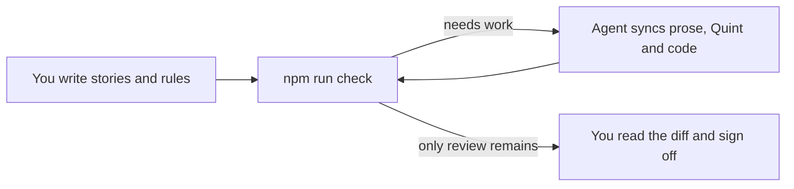

<div align="center">

# Vibespec (Starter Template)

**Write user stories. Get formally verified TypeScript.**

A Markdown spec tree starts at `spec/index.md` and holds the stories, the
rules each story implies, and under every rule a few lines of
[Quint](https://quint-lang.org) that say it exactly. Link to child specs to
keep each area small. Everything else is generated, simulated and proved with
[Dafny](https://dafny.org). The coding agent in your session keeps prose and
model in step; you sign off.

[](https://github.com/lalalune/vibespec-starter/generate)

[](https://github.com/lalalune/vibespec-starter/actions/workflows/check.yml)

[Getting started](#getting-started) ·
[Project setup](#set-up-a-new-project) ·
[Studio](#studio) ·
[Build your project](#build-your-project) ·
[Examples](#examples) ·
[How it works](#what-npm-run-check-checks) ·
[Guarantees](#what-is-and-is-not-guaranteed) ·
[Spec reference](AGENTS.md#spec-reference)

</div>

---

## Why

Agents write code fast; reading all of it is the slow part. Vibespec moves
what you must read to the top: a short list of sentences a product owner
would call true or false, each with its formal meaning underneath. From
there:

- **Generated, not written.** Types, guards, transitions and rule checks in
  `gen/<name>.ts` come from the spec. Nobody edits them.
- **Simulated.** Thousands of random traces look for a reachable state that
  breaks a rule, and report the shortest one.
- **Proved.** Dafny proves that every transition keeps every rule, for all
  states and all inputs, and that your hand-written logic meets its contract.
- **Reviewed.** Every rule that changed is shown with its sentence and its
  Quint side by side, and nothing is done until you sign off.


The template's `spec/index.md` is blank, ready for your application.

## Getting started

**Needs** Node 24+ and [Dafny](https://github.com/dafny-lang/dafny/releases)
4.11 on the `PATH`. Packages with `src/` or `test/` also need a
`tsconfig.json` so the generated contract is checked against the application.

1. Click **[Use this template](https://github.com/lalalune/vibespec-starter/generate)**
   to create your own repository, then clone it and enter its directory.
2. Install the toolchain and open your project in Studio:

   ```bash
   npm install
   npm run dev
   ```

3. In `spec/index.md`, give your application a title and add its first story:
   who it is for, what they need to do, and why. You can write it in Studio
   or edit the Markdown file directly.
4. Publish your edits, then ask the coding agent to sync. It writes the
   rules and Quint, runs checks, and reports what needs your review.
5. Build your application's UI, API or other shell in `src/`, importing the
   generated code from `gen/`. Follow [Build your project](#build-your-project).

`npm install` builds the `spec` command and generates `gen/` when every spec
is valid. Nothing needs to be copied from an example. To adopt your project's
own metadata and documentation, see [project setup](#set-up-a-new-project).

## Studio

```bash
npm run dev
```

Studio opens the current project. Start in its blank `spec/index.md`: edit
the title, use **Story** to describe a user need, and add rules as they become
clear. **Publish** saves your edits to disk and runs checks. Use the sync
prompt with Claude Code or Codex to turn those requirements into a checked
model. After reviewing the result, **Sign off** records the same approval as
`npm run accept`.

To open another project, pass its directory:

```bash
npm run dev -- ../my-project
npm run dev -- "/absolute/path/to/my project"
```

The path is the project root containing `spec/`; relative paths are resolved
from the directory where you run the command. With the packaged CLI, use
`npx spec studio <project-path>`. Studio opens only the selected project, using
its specs, source, tests and review ledger throughout. See [Examples](#examples)
for the bundled project paths.

For a terminal workflow, `node vibespec/spec.ts watch` reruns checks when a
spec, source file or test changes.

## Build your project

### 1. Write your requirements

Start with your application's stories in `spec/index.md`. A `##` heading is
a story, a `###` heading is a rule, and a `quint` block under a rule states
its formal meaning. Describe the behavior you want in prose first; the
agent can write the rules and their Quint.

If you want a small scaffold to replace with your requirements, run
`npm run new`. It fills an empty root index with one story, a state, a
guarded transition, an `always` rule and a `sometimes` rule. It never
replaces a non-empty spec.

### 2. Sync and check

Ask the agent in your session to sync. Claude Code loads the
[`sync` skill](.claude/skills/sync/SKILL.md); other agents follow
[AGENTS.md](AGENTS.md).



You can run the same checks from the terminal:

```bash
npm run check
```

In this starter repository, that command checks the root project and then
every example workspace. To check just your project, or a project in another
directory, use the CLI directly:

```bash
node vibespec/spec.ts check .
node vibespec/spec.ts check ../my-project
```

Each report ends with a `next:` line. The agent follows it until only your
review remains:

| `npm run check` reports | The agent writes |
|---|---|
| story has no rules | rules, then their Quint |
| not formalized | Quint that says what the sentence says, and no more |
| prose changed | Quint, if the meaning moved |
| model changed | the sentence, to match the Quint |
| a trace breaks a rule | the missing reason, as a new rule |
| not proved | a proof, or the missing fact as a new rule |

The agent reports any rules discovered by the checks and anything it could
not formalize or prove. It runs `npm run accept` only when you ask.

### 3. Build on the generated code

`npm run check` generates your types, guards and transitions in `gen/`.
For a state machine, import its `initial`, `parseEvent`, `enabled` and
`step` into your application:

```ts
import { initial, parseEvent, enabled, step } from "../gen/index.ts";
```

Keep the current state in your shell. Parse incoming data with `parseEvent`,
check whether `enabled` allows it, then apply `step` and save the resulting
state. Pass stored state through `parseState` when loading it. If the spec
uses a sender parameter named `by`, authenticate that sender in your shell
and pass it separately to `enabled` and `step`.

Put UI, HTTP, storage and other I/O in `src/`, with whole-journey tests in
`test/`. Keep pure logic in the spec wherever Quint can express it. Logic
that needs TypeScript, such as a loop, can carry
[LemmaScript](https://github.com/midspiral/LemmaScript) contracts and be
proved too. When the spec changes, `tsc` points at application code that
must follow. Never edit `gen/`.

### 4. Grow the spec by area

`npm run new -- billing` creates `spec/billing/index.md`;
`npm run new -- billing/payments` creates a nested area. Link to child
specs from their parent index:

```markdown
[Billing](./billing/)
```

`check` discovers every Markdown spec recursively. Links organize
navigation; Quint imports share definitions. Module names follow paths:
`spec/index.md` → `gen/index.ts`, `spec/billing/index.md` → `gen/billing.ts`,
and `spec/billing/payments/index.md` → `gen/billing__payments.ts`.
See the [spec reference](AGENTS.md#writing-a-spec).

### 5. Review and sign off

When only `review` items remain, read the diff of `spec/`, `src/` and `test/`.
Check that each rule's sentence and Quint say the same thing, then run:

```bash
npm run accept
```

`accept` checks afresh and records what `review` lists in `spec/lock.json`,
[all or nothing](AGENTS.md#review). Commit the ledger with the spec.

## Set up a new project

Before committing your application's starting point:

1. **Use your own metadata.** Update the package name, description and
   repository links. Remove `vibespec/examples/` when you no longer need
   the reference projects, along with their workspace entries, npm scripts
   and CI steps such as `demo` and `check:dashboard`. Set `check` to
   `node vibespec/spec.ts check` after removing the workspaces.
2. **Keep the toolchain guide with the toolchain.** Move this README to
   `vibespec/README.md`, update its relative links and the guide references
   in `AGENTS.md` and the skills, and keep the template license in
   `vibespec/LICENSE` alongside the retained Vibespec code.
3. **Write your project's documentation.** Create a root `README.md` with
   the project's purpose and install, run and check commands. Set the root
   `LICENSE` to the project's chosen terms and copyright holder.
4. **Check and commit.** Run `npm install` and `npm run check`, resolve their
   reports, and review and accept the spec. Commit the setup and reviewed
   ledger, then confirm `git status --short` is empty.

## Commands

| Command | Does |
|---|---|
| `npm run dev` / `npm run dev -- <project-path>` | Opens Studio for the current project or the supplied project directory |
| `npx spec studio <project-path>` | Opens another project with the packaged CLI |
| `npm run check` | Checks the root project, then all example workspaces; ends each project with a `next:` line |
| `npm run check --workspaces --if-present` | Checks all bundled example workspaces |
| `node vibespec/spec.ts check <directory>` | Checks only the selected project |
| `node vibespec/spec.ts check <directory> --json` | The selected project's check as one JSON object ([shape](AGENTS.md#changing-the-tools)) |
| `npm run gen` | Generates `gen/` only |
| `node vibespec/spec.ts gen <directory>` | Generates the selected project's `gen/` only |
| `node vibespec/spec.ts watch <directory>` | Rechecks the selected project when its spec, source or tests change |
| `npm run accept` | The user's sign-off: checks afresh and records what `review` lists, [all or nothing](AGENTS.md#review) |
| `node vibespec/spec.ts accept <directory>` | Signs off on the selected project's reviewed changes |
| `npm run accept -- unproved` | Records the listed obligations as simulated only. The user's decision |
| `npm run new` / `npm run new -- <path>` | Fills an empty root index or creates a child [starter spec](AGENTS.md#writing-a-spec) |
| `node vibespec/spec.ts migrate <directory>` | Consolidates that project's old review ledgers into `spec/lock.json`, preserving their recorded approvals |
| `npm run demo` | Runs the order example's scripted checkout session |
| `npm run check:dashboard` | `check` on `vibespec/examples/dashboard` |
| `npm run selftest` | Breaks the pipeline one way at a time and checks each break is caught |
| `npm run build` | Compiles the tools into `dist/`, the packaged `spec` command |
| `node vibespec/spec.ts init <directory>` | Sets up an existing project folder; see [Using it from another package](AGENTS.md#using-it-from-another-package) |

Run the `node vibespec/spec.ts` commands from this repository's root. When
Vibespec is installed as a package in another project, use `npx spec` with
the same command and arguments instead.

Omit `<directory>` to use the current project.
Pass a project folder, not an individual Markdown file; `init` creates its
`spec/` directory when needed.
Relative paths, absolute paths and quoted paths containing spaces are supported.

| Exit code | Means |
|---|---|
| 0 | green |
| 1 | a `✗`, or an error |
| 2 | bad arguments; prints the usage line |

## What `npm run check` checks

Stages run cheapest first. `✓` passed, `✗` failed, `-` skipped: blocked by a
`✗` above, or (`types`) there is no `tsconfig.json` and no source or tests to typecheck.

| Stage | Question | Strength |
|---|---|---|
| `model` | Is the spec well-typed and inside the supported subset? | exact; anything unsupported is refused by name |
| `always` | Does a reachable state break an `always` rule, a step break a `step` rule, a sampled argument break a law, or a fair run that stops or loops break a [`leadsTo` rule](AGENTS.md#liveness)? | 10,000 random traces; a failure comes with the shortest trace and its seed |
| `sometimes` | Can each `sometimes` goal be reached? Does each guard allow its event in some reachable state? | a witness trace is a proof; a failure means searches of 20, 40 and 100 events found none (200,000 traces at depth 20, with proportionally fewer at larger depths). [Guards never seen to refuse](AGENTS.md#writing-good-rules) are listed, not failed |
| `replay` | Does the generated TypeScript mean what the Quint means? | 400 sampled traces and every witness: every state, every law, and every definition the simulator can evaluate. The rest are listed |
| `types` | Does the application fit the generated contract? | exact |
| `proof` | Does every transition preserve every `always` and `step` rule, does every law hold, and does hand-written logic meet its `//@` contract? | all states, all inputs, counted per obligation under a fixed resource limit. What Dafny cannot prove alone is proved in a proof file (`spec/<path>.proof.dfy`: lemmas only, checked to add nothing but proof), or listed; a listed obligation passes only once the user records it in `spec/lock.json` under `unproved`, for that text of the unit |
| `tests` | Does the shell work with the real services around it? | whole user journeys, where the checks above cannot see ([AGENTS.md](AGENTS.md#tests)) |
| `review` | Does every story have rules and every rule Quint? Has every new or changed story, rule and `//@` contract been reconciled? | exact |

## What lives where

Keep `spec/`, `src/`, `test/` and `vibespec/` in git, lock files included.
`gen/`, `dist/` and `.spec-cache/` are derived and ignored by git; never edit them.

| Path | Role |
|---|---|
| `spec/index.md`, `spec/**/index.md`, `spec/**/*.md` | The spec tree: stories, rules, Quint and links; the template root is blank |
| `spec/lock.json` | Versioned review ledger: `specs` by source path, `contracts` by source file, and `unproved` by proof unit |
| `spec/<path>.proof.dfy`, `src/<path>.proof.dfy` | Proofs, in Dafny lemmas, of obligations Dafny cannot prove alone. Written by the agent; optional |
| `.spec-cache/` | Remembered results, and `lock`: one check or accept per project at a time |
| `.claude/skills/sync/SKILL.md` | How the agent in your session keeps stories, rules and model in step |
| `.claude/skills/design/SKILL.md` | How the agent designs what a person sees: only what the spec asks, visual first, few words |
| `vibespec/spec.ts` | The pipeline and command line |
| `vibespec/parse.ts`, `vibespec/review.ts` | Literate specs and review ledgers |
| `vibespec/cache.ts`, `vibespec/run.ts` | Stage caches and bounded tool execution |
| `vibespec/units.ts`, `vibespec/simulate.ts`, `vibespec/util.ts` | Generation, proof units, simulation, replay and shell tests |
| `vibespec/prove.ts`, `vibespec/proof/lib.dfy` | The proof stage for one unit, with the checks on proof files, and the library of general lemmas proof files call |
| `vibespec/gen.ts`, `vibespec/gen/` | Quint → TypeScript and the simulation harness |
| `vibespec/selftest.ts`, `vibespec/fixtures/` | Tests of the pipeline itself, and the small specs they use |
| `vibespec/examples/order/src/ledger.ts` | Hand-written logic, proved against the generated contract |
| `vibespec/examples/order/src/app.ts`, `vibespec/examples/order/src/demo.ts` | Unverified shell: storage, input parsing, error reporting; and the demo |
| `vibespec/examples/order/test/app.test.ts` | Tests of the shell, run by the `tests` stage |
| `vibespec/examples/order/` | Complete checkout example, with its own spec, shell and tests |
| `vibespec/examples/dashboard/` | A larger, synthesized example, as a separate package |
| `.github/workflows/check.yml` | Continuous integration: `npm run check` without the cache |
| **Derived** (not in git) | |
| `gen/<name>.ts`, `gen/<name>.qnt` | Generated TypeScript, and the tangled Quint model |
| `gen/<name>.run.qnt` | The simulation harness that `npx quint run` and `quint verify` take |
| `gen/traces/`, `gen/proof/` | The last simulated traces; the final Dafny and logs of each proof unit |
| `dist/` | The built `spec` command, from `npm run build` |

## Examples

These projects are optional references. From the repository root, pass an
example's directory to open its specs in Studio:

| Project | What it covers | Open in Studio |
|---|---|---|
| [Order checkout](vibespec/examples/order/README.md) | Guards, payments, cancellation and a proved event ledger | `npm run dev -- vibespec/examples/order` |
| [Team dashboard](vibespec/examples/dashboard/README.md) | Shared spreadsheets, chat notifications and a project registry | `npm run dev -- vibespec/examples/dashboard` |
| [Shared to-do list](vibespec/examples/fullstack/README.md) | HTTP server, browser client and two tabs over an unreliable network | `npm run dev -- vibespec/examples/fullstack` |
| [Assistant](vibespec/examples/assistant/README.md) | Trusted senders, bounded turns, late replies and confirmation before payment | `npm run dev -- vibespec/examples/assistant` |

The same argument accepts any project directory containing `spec/`, including
projects outside this repository. Studio edits and checks the selected
project; the examples with executable applications also have their own
run commands below. Check or generate one example by passing its path:

```bash
node vibespec/spec.ts check vibespec/examples/order
node vibespec/spec.ts gen vibespec/examples/order
```

Replace the path to work on any other project. Output and caches stay in the
selected project. Check every bundled example with:

```bash
npm run check --workspaces --if-present
```

### Order checkout

The [order example](vibespec/examples/order/README.md) is a checkout
(`vibespec/examples/order/spec/index.md`, about 250 lines): fill a draft, submit, pay
in instalments, hold, cancel, reopen.

| Order example | |
|---|---|
| Model | 10 transitions, 6 `always`, 1 `step`, 3 `sometimes` rules |
| Proved, spec | 72 obligations, all states and inputs |
| Proved, `vibespec/examples/order/src/ledger.ts` | 2 hand-written functions, 3 obligations |

Run the scripted application from the repository root:

```bash
npm run demo
```

`npm run demo` generates and runs `vibespec/examples/order`, driving the verified checkout
through a scripted session; every `✗` is a rule refusing an event:

```
✗ {"type":"submit"}              submit is not allowed for a Draft order
✓ {"type":"addItem","qty":2}     {"status":"Draft","units":2,"due":10,"paid":0}
✓ {"type":"submit"}              {"status":"Pending","units":2,"due":10,"paid":0}
✓ {"type":"pay","amount":4}      {"status":"Pending","units":2,"due":10,"paid":4}
✗ {"type":"pay","amount":7}      pay is not allowed for a Pending order
✓ {"type":"pay","amount":6}      {"status":"Paid","units":2,"due":10,"paid":10}
✗ {"type":"cancel"}              cancel is not allowed for a Paid order
balance 0
```

#### Read the spec

In [the order spec](vibespec/examples/order/spec/index.md), `##` is a story, `###` a
rule, and the `quint` block under a rule is its formal half.

````markdown
## Story: Check out

> As a shopper, I want to submit my order and pay it off in one or more
> payments, so that I do not need the whole amount at once.

### A payment never exceeds the balance

A payment is a positive amount toward a pending order. The payment that
clears the balance marks the order as paid.

```quint
pure def canPay(o: Order, amount: int): bool =
  o.status == Pending and amount > 0 and o.paid + amount <= o.due

pure def pay(o: Order, amount: int): Order =
  val paid = o.paid + amount
  { ...o, paid: paid, status: if (paid == o.due) Paid else Pending }
```

### A pending order still has a balance

```quint
pure def alwaysPendingHasBalance(o: Order): bool =
  o.status == Pending implies o.paid < o.due
```
````

There is no state machine to write. A definition's name and signature give
its role ([all of them](AGENTS.md#what-goes-in-the-quint-blocks)):

| You write | It is |
|---|---|
| `pure val initial: Order` | the initial state; its type is the state type |
| `pure def pay(o: Order, …): Order` | a transition, and an event `{ type: "pay", amount }` |
| `pure def canPay(o: Order, …): bool` | the guard of `pay` |
| `pure def alwaysX(o: Order): bool` | holds in every reachable state |
| `pure def stepX(before: Order, after: Order): bool` | holds across every transition |
| `pure def sometimesX(o: Order): bool` | some reachable state has it |
| `pure def leadsToX(o: Order, later: Order): bool` | every fair run from `o` reaches such a `later` |
| `pure def lawX(…): bool` | true for every argument |

The example's `gen/index.ts` gets the same definitions in TypeScript. Each
transition carries one obligation per rule, which Dafny proves:

```ts
/** Story: Check out / A payment never exceeds the balance (spec/index.md:73) */
//@ pure
export function pay(o: Order, amount: number): Order {
  //@ ensures (inv(o) && canPay(o, amount)) ==> alwaysPendingHasBalance(\result)
  //@ ensures (inv(o) && canPay(o, amount)) ==> stepNothingIsPaidOnHold(o, \result)
  // … one per always and step rule
  const paid = o.paid + amount;
  return { ...o, paid: paid, status: paid === o.due ? "Paid" : "Pending" };
}

export function parseEvent(x: unknown): Event | undefined  // untrusted input → event, or not
export function enabled(current: Order, event: Event): boolean
export function step(current: Order, event: Event): Order
export function inv(current: Order): boolean               // every always rule at once
```

#### When simulation finds a missing rule

Weaken `canSubmit` in the order example to `o.status == Draft`, and the
`always` stage finds the shortest trace to a broken rule:

```
✗ always    spec/index.md: a reachable state breaks "Story: Check out /
            A pending order still has a balance" (spec/index.md:93)
      initial                        -> {"status":"Draft","units":0,"due":0,"paid":0}
      {"type":"submit"}              -> {"status":"Pending","units":0,"due":0,"paid":0}
      last event: "Story: Check out / Only a non-empty draft can be submitted" (spec/index.md:63); its guard canSubmit let it through
      fallback: refuse submit when its result would break alwaysPendingHasBalance
      seed …; to simulate again: npx quint run gen/index.run.qnt …
```

The fix is the *reason*, written as a rule in the user's words. Rules found
this way say so: see "No more can be removed than the order holds" in
[the order spec](vibespec/examples/order/spec/index.md).

#### When a proof fails

A rule can hold on every trace and still not be provable, because the proof
starts from *any* state that satisfies the rules, reachable or not. Delete
"Drafts and cancelled orders hold no money" from the order example: every
trace still passes, but Dafny now considers a draft that is already paid,
and `submit` can no longer be proved to leave a balance.

[Three ways out](AGENTS.md#when-a-proof-does-not-go-through). First
decide whether the obligation holds in every state that satisfies the rules.
If you can name one where it does not, as with the paid draft here, no proof
can help.

1. **Prove it**, if it holds, in `spec/<path>.proof.dfy`, with Dafny lemmas
   only. The tools refuse anything that would assume rather than prove.
2. **State the missing fact** as a new `always` rule, if it does not. "An
   order on hold still has a balance" in the order example was found this way.
3. **Accept it as simulated only**, with `npm run accept -- unproved`, for a
   spec only: hand-written code must be proved. Your decision, never the
   agent's, and it lapses when the spec or its proof file changes.

#### Follow the generated code into the application

Application code goes through `parseEvent`, `enabled` and `step`, as
[the order shell](vibespec/examples/order/src/app.ts) does:

```ts
dispatch(id: string, input: unknown): Order {
  const event = parseEvent(input);
  if (!event) throw new Rejected("not a well-formed event");
  const order = this.get(id);
  if (!enabled(order, event)) throw new Rejected(`${event.type} is not allowed …`);
  …
}
```

Logic Quint cannot express, such as a loop over an event log, is written in
TypeScript with [LemmaScript](https://github.com/midspiral/LemmaScript)
contracts and proved too. From [the order ledger](vibespec/examples/order/src/ledger.ts):

```ts
export function replay(events: Event[]): Order {
  //@ ensures inv(\result)
  …
}
```

When the spec changes, `tsc` points at every line of `src/` that must follow.

### Team dashboard

`vibespec/examples/dashboard` is a synthesized team task dashboard with made-up names
and data: tasks live in a shared spreadsheet that people also edit by hand, a
chat app carries commands and notifications, and a web page shows the state.

| Spec | Models | Rules | Proved |
|---|---|---|---|
| `kernel.md` | Arithmetic library | 10 laws | 10 obligations |
| `tracker.md` | One project's sheet: guarded dashboard edits, unguarded hand edits | 20 transitions; 10 `always`, 4 `step`, 4 `sometimes` | 282 obligations |
| `projects.md` | The registry of projects | 4 transitions; 2 `always`, 1 `step`, 1 `sometimes`, 1 law | 15 obligations |
| `src/columns.ts` | Hand-written logic | `//@` contracts | 4 obligations |

Every obligation is proved for all states and inputs.

Modelling an owners cell as a list, not a set, exposed a case a set cannot
express: a name typed twice. The rule "A person named twice in a cell is told
once" covers it, and `src/notify.ts` sends each person one message.

### Shared to-do list

Run the application from the repository root, then open
[localhost:3000](http://localhost:3000) in two browser windows:

```bash
node vibespec/spec.ts gen vibespec/examples/fullstack
npm start --workspace fullstack-todo
```

The [project guide](vibespec/examples/fullstack/README.md) explains the
backend, browser synchronization and their joint model.

### Assistant

The [assistant guide](vibespec/examples/assistant/README.md) walks through
trusted senders, a durable outbox and a bill payment requiring confirmation.
This is a model and trust-boundary test, without live authentication,
browser control or payment execution.

## What is and is not guaranteed

Proved for all states and inputs: the initial state satisfies every `always`
rule, every transition preserves every `always` and `step` rule, every law
holds, and hand-written `//@ ensures` hold, except for obligations listed in
`spec/lock.json` under `unproved` (spec units only; hand-written code must be proved)
and those resting on them, which every proof line lists. The order example has
none. Proof files add only lemmas, and those are proved too
([what they may use](AGENTS.md#proof-files)).

Trusted, not proved:

- **The prose.** Whether the Quint under a rule means what the sentence above
  it says is a judgement. The `review` stage makes sure someone made it.
- **The generator** (`vibespec/gen.ts`, `vibespec/gen/`). Simulation checks the Quint model; the proof checks the
  TypeScript. `replay` ties the two together on sampled traces only.
- **The shell** (`vibespec/examples/order/src/app.ts`), LemmaScript, Dafny and Quint.
- **Built-ins.** The proofs assume that built-ins such as `Math` and
  `Array.prototype` are not modified at run time, anywhere in the process.
- **Preconditions.** A `//@ requires` that can never hold makes a contract
  vacuous: everything after it is proved. That is why contracts are reviewed,
  through `spec/lock.json` under `contracts`.
- **Numbers.** The proofs treat `number` as an unbounded integer. The
  generated `parseEvent` admits only safe integers, but nothing stops sums of
  them from passing 2^53, where JavaScript arithmetic is no longer exact.
- **The working directory.** Anyone who can edit `gen/`, `.spec-cache/` or the
  tools can make `check` say what they like. `accept` ignores the cache, and
  continuous integration starts without `.spec-cache/`, which is not in git.

## FAQ

**Do I need to know Quint or Dafny?** To read a spec, a little Quint: it
reads like typed functional pseudocode, and each block sits under the
sentence it formalizes. Dafny you rarely see; when a proof needs help, the
agent writes the lemmas.

**What can a spec express?** Records, variants, lists, sets, maps, integers,
strings and booleans, with folds instead of loops. Anything outside the
subset is refused by name ([supported Quint](AGENTS.md#supported-quint)).

**What about I/O, HTTP and storage?** That is the shell, written by hand
around the generated core and covered by tests.

**Which agent?** Claude Code loads the skills in `.claude/skills/` directly.
Any other agent reads [AGENTS.md](AGENTS.md).

**Can I check harder than simulation?** Yes: run the Apalache model checker
on the generated harness, exhaustively up to a depth
([checking harder](AGENTS.md#checking-harder)).

## Contributing

How the repository works, the spec format, proof files and how to change the
tools are in [AGENTS.md](AGENTS.md); every agent reads it and this README in
full before doing any work. A change to `vibespec/` needs
`npm run selftest` to pass, with a new case for each new kind of mistake it
catches.

## License

[MIT](LICENSE)
