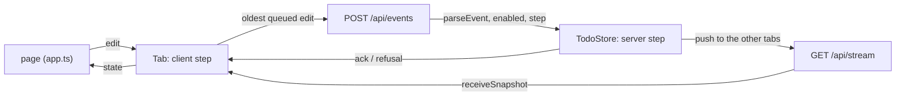

# Shared to-do list, modelled end to end

A small full-stack application: a Node.js backend with an HTTP API and a
React page, sharing one to-do list between browser tabs that may go offline.
Both halves run the state machines generated from `spec/`, and a fourth spec
puts the server, two tabs and an unreliable network together and checks the
rules only the whole system can state.

```sh
npm run check      # the whole pipeline (from this directory)
npm start          # then open http://localhost:3000 in two windows
```

Needs Node 24+ (the server strips TypeScript types itself, so there is no
build step) and Dafny on the path. The page loads React 18 from esm.sh.

| Path | Kind | What it covers |
|---|---|---|
| `spec/todo.md` | library, 4 laws | A to-do, the four edits, when an edit makes sense, how it is applied, list equality |
| `spec/server.md` | state machine, 5 transitions | The backend: one request per edit, each request answered once and recognised as a retry only with the same edit, version = number of changes, ids never reused |
| `spec/client.md` | state machine, 9 transitions | One tab: confirmed copy + queue of unanswered edits, optimistic view, offline, answers and pushes |
| `spec/system.md` | state machine, 9 transitions | Server + tabs `a` and `b` + a network that loses, repeats and reorders + anyone forging requests in a tab's name; a ghost history of every version |
| `spec/*.proof.dfy` | proofs | Everything Dafny could not prove alone (uniqueness under append/filter/map, fold lemmas, the system rules) |
| `src/server.ts`, `src/main.ts` | backend shell | `node:http`: `POST /api/events`, `GET /api/stream` (server-sent pushes, the current list first), and the frontend's files |
| `src/protocol.ts` | shared shell | Wire format; a queued edit as a server event |
| `src/web/sync.ts` | frontend shell | `Tab`: the generated client machine, its send queue and push stream |
| `src/web/app.ts`, `index.html` | frontend shell | React page over a `Tab` |
| `test/` | tests | the HTTP API and two tabs against the real server |

## How the halves fit



## What is proved, simulated and trusted

- **Proved**: every transition of the server, the client and the system
  keeps every `always` and `step` rule, and every law holds. At the system
  level that includes: each part keeps its own rules, no tab is ahead of the
  server, and every copy of the list, in a tab or in flight, is exactly the
  list as it was at the version it carries.
- **Simulated**: all of the above on random traces, and the `sometimes`
  rules, among them that two tabs that both edited can converge on the
  server's list despite loss, duplication and reordering.
- **Tested**: the HTTP shell, the push stream, the tab's network code and a
  two-tab run against the real server (`test/`).
- **Trusted**: the shell (`src/server.ts`, `src/web/`), React, the
  generator, LemmaScript, Dafny and Quint. Convergence is a `sometimes`
  rule: the model shows it can happen, not that it always does.

## Limits of the spec language met here

- **A machine cannot be imported with `.*`**, and two machines whose
  transitions share names (`create`, `initial`) could not be anyway; the
  system spec uses `S::` and `C::`.
- **Proofs about an imported machine's transitions cannot be reused.** The
  system unit is proved against the server's and client's definitions, not
  their proofs. The server and client therefore restate "a commit / refusal /
  queued edit / answer keeps the rules" as laws, which the system proof file
  calls as `server_law…_ensures` and `client_law…_ensures`.
- **Folds over records need a named type.** `foldl` with an anonymous record
  accumulator is refused (`unsupported type rec`), hence `Walk` and `Cut`.
- **A helper that takes the state first and returns it is a transition**, so
  helpers such as `commit`, `queue`, `withClient` take it second.
- **Sample sets are per spec.** `<param>Values` in an imported library is
  not used for the importing spec's parameters, and two specs that define the
  same name cannot be imported `.*` together, so the library's sets have
  their own names (`changeValues`, `xsValues`).
- **The HTTP and React layers are outside the model.** Retry timing, the
  push stream and the DOM are tested, not proved.
