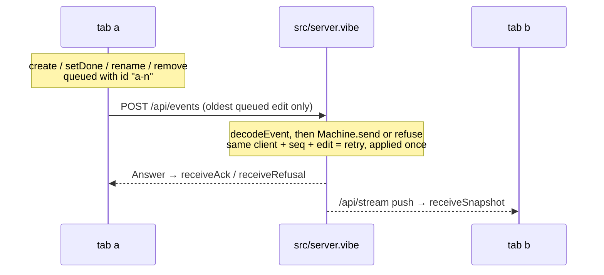

# Shared to-do list, modelled end to end

A Node.js backend and a React page share one to-do list between browser tabs
that may go offline. Both run the machines generated from `spec/`; a fourth
spec puts the server, two tabs and an unreliable network together.

```sh
pnpm install --ignore-workspace   # here, after the install at the repository root
pnpm check      # the whole pipeline (from this directory)
pnpm test       # the tests alone, against the real server on a free port
pnpm start      # build, then open http://localhost:3000 in two windows
pnpm storybook  # every component of the page in each of its states
pnpm lint       # the page uses the design tokens only
```

Needs Node 26+ and Dafny on the path.

| Path | Kind | Covers |
|---|---|---|
| `spec/todo.md` | library | A to-do, the four edits, when an edit makes sense, how it is applied |
| `spec/server.md` | machine | One request per edit, answered once, version = number of changes, ids never reused |
| `spec/client.md` | machine | One tab: confirmed copy, queue of unanswered edits, offline, answers and pushes |
| `spec/system.md` | machine | Server + tabs `a` and `b` + a lossy, repeating, reordering network + forged requests |
| `spec/*.proof.dfy` | proofs | What Dafny could not prove alone |
| `src/server.vibe`, `src/main.vibe` | backend shell | `POST /api/events`, `GET /api/snapshot`, `GET /api/stream`, the page's files |
| `src/protocol.vibe` | shared shell | Wire format |
| `src/web/sync.vibe` | frontend shell | The `Tab` service: one client machine and its requests, shared with `test/e2e.test.vibe` |
| `src/web/` | page | React: `useTab.ts` gives `components/TodoPage.tsx` the tab's `Client` and its effects |
| `tokens.json`, `design.md` | design | The page's colors and shapes, as tokens |



## VibeLang and TypeScript

The shell is [VibeLang](https://github.com/smithersai/vibelang) (`.vibe`):
TypeScript syntax for Effect, on `gen/<name>.effect.vibe`, which `pnpm gen`
writes beside each generated module. The server is Effect's `HttpRouter` over
the generated `Machine` service; a tab changes its `Client` only with `apply`.

| Stays TypeScript | Why |
|---|---|
| `gen/*.ts` | generated, and what the proofs are about |
| `src/web/**/*.tsx`, `useTab.ts` | React and the DOM, which a `.vibe` file cannot touch; `useTab.ts` runs the tab's effects through a `ManagedRuntime` |
| `vite.config.ts`, `vitest.config.ts`, `eslint.config.js`, `.storybook/` | configuration the tools load themselves |

## The page

The `Tab` of `sync.vibe` owns the client's state. `useTab.ts` hands every
state it publishes to `TodoPage`, whose components take that `Client` and
callbacks as props, offer a control exactly when the generated guard allows
its event (`canCreate`, `canSetDone`, `canRename`, `canRemove`, `canGoOffline`,
`canGoOnline`), and keep only text being typed in `useState`.

| Command | Does |
|---|---|
| `pnpm build` | the server (`vibelang`, to `dist/src`), the theme, and the page (Vite, to `dist/web`, which the server serves) |
| `pnpm tokens` | `generated/theme.css` and the table in `design.md`, from `tokens.json`; `node ../../spec.ts tokens check` fails on contrast below WCAG AA |
| `pnpm stories` | `generated/stories/`: stories of each component in `src/web/components/`, from its props and its `<Name>.meta.tsx`, and a test that mounts each |
| `pnpm storybook` | Storybook over those stories, regenerated as components change |

`pnpm test` writes the theme and the stories, has Vitest build the page
(`test/page.ts`), and runs the shell's journeys and the mount of every story.

## Proved, simulated, tested, trusted

- **Proved**: every transition of server, client and system keeps every
  `always` and `step` rule, and every law holds. `pnpm check` gives the count.
- **Simulated**: the `sometimes` rules, among them that both tabs can finish
  their edits and agree with the server despite loss, duplication and reordering.
- **Tested**: the HTTP shell and two tabs against the real server (`test/`);
  that every story mounts. No test drives the page in a browser.
- **Trusted**: `src/`, React, Effect, the VibeLang compiler, the generator,
  Dafny and Quint. Convergence is a `sometimes` rule: the model shows it can
  happen, not that it always does.

## Simplifying it

The specs were written before the tools could do the following, and still
work around their absence. Each is a good first exercise:

- **Imported proofs.** The server and client restate "a commit / refusal /
  queued edit / answer keeps the rules" as laws for the system proof file.
  It can call `server_<transition>_ensures` and `client_<transition>_ensures`
  instead (AGENTS.md, "Proof files").
- **Equality.** `sameTodos` and its reflexivity law can become `==`, which
  compares lists and records by structure.
- **List operations.** `dropAt`, and its induction, can become `removeAt`.
- **Liveness.** "Both tabs eventually agree" is stated as "sometimes they
  agree"; a `leadsTo` rule with `fair_` events can state it (SPEC.md,
  "Liveness").

## Limits of the spec language met here

- **A machine cannot be imported with `.*`**; the system spec uses `S::` and `C::`.
- **Folds over records need a named type**, hence `Walk` and `Cut`.
- **A helper that takes the state first and returns it is a transition**, so
  `commit`, `queue` and `withClient` take it second.
