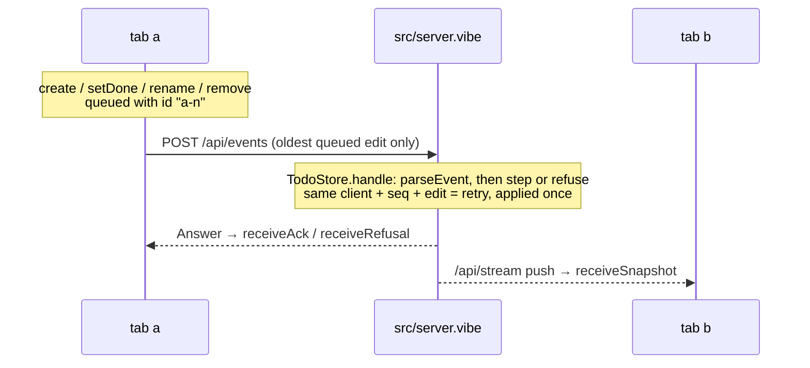

# Shared to-do list, modelled end to end

A Node.js backend and a React page share one to-do list between browser tabs
that may go offline. Both run the machines generated from `spec/`; a fourth
spec puts the server, two tabs and an unreliable network together.

```sh
pnpm install
pnpm check      # the whole pipeline (from this directory)
pnpm start          # then open http://localhost:3000 in two windows
```

Needs Node 26 and Dafny on the path. The page loads React 18 from esm.sh.

| Path | Kind | Covers |
|---|---|---|
| `spec/todo.md` | library | A to-do, the four edits, when an edit makes sense, how it is applied |
| `spec/server.md` | machine | One request per edit, answered once, version = number of changes, ids never reused |
| `spec/client.md` | machine | One tab: confirmed copy, queue of unanswered edits, offline, answers and pushes |
| `spec/system.md` | machine | Server + tabs `a` and `b` + a lossy, repeating, reordering network + forged requests |
| `spec/*.proof.dfy` | proofs | What Dafny could not prove alone |
| `src/server.vibe`, `src/main.vibe` | backend shell | `POST /api/events`, `GET /api/snapshot`, `GET /api/stream`, the page's files |
| `src/protocol.vibe` | shared shell | Wire format |
| `src/web/` | frontend shell | React page and the network code it shares with `test/e2e.test.vibe` |



## Proved, simulated, tested, trusted

- **Proved**: every transition of server, client and system keeps every
  `always` and `step` rule, and every law is a proof obligation.
  `pnpm check` reports which obligations are proved.
- **Simulated**: the `sometimes` rules, among them that both tabs can finish
  their edits and agree with the server despite loss, duplication and reordering.
- **Tested**: the HTTP shell and two tabs against the real server (`test/`).
- **Trusted**: `src/`, React, the generator, Dafny and Quint. Convergence is
  a `sometimes` rule: the model shows it can happen, not that it always does.

## Limits of the spec language met here

- **A machine cannot be imported with `.*`**; the system spec uses `S::` and `C::`.
- **Folds over records need a named type**, hence `Walk` and `Cut`.
- **A helper that takes the state first and returns it is a transition**, so
  `commit`, `queue` and `withClient` take it second.

## Simplifying it

The specs were written before the tools could do the following, and still
work around their absence. Each is a good first exercise:

- **Imported proofs.** The server and client restate "a commit / refusal /
  queued edit / answer keeps the rules" as laws for the system proof file.
  It can call `server_<transition>_ensures` and `client_<transition>_ensures`
  instead (AGENTS.md, "Proof files").
- **Equality.** `sameTodos` and its reflexivity law can become `==`, which
  compares lists and records by structure.
- **List operations.** `dropAt`, and its induction, can become `removeAt`.
- **Liveness.** "Both tabs eventually agree" is stated as "sometimes they
  agree"; a `leadsTo` rule with `fair_` events can state it (AGENTS.md,
  "Liveness").

The VibeLang shell serves the API through Effect HTTP services. The page reads
the `Tab` service and sends events through its generated client adapter.
`pnpm build` emits the backend and bundles the page; `pnpm test` exercises the
real HTTP server and two tabs.
