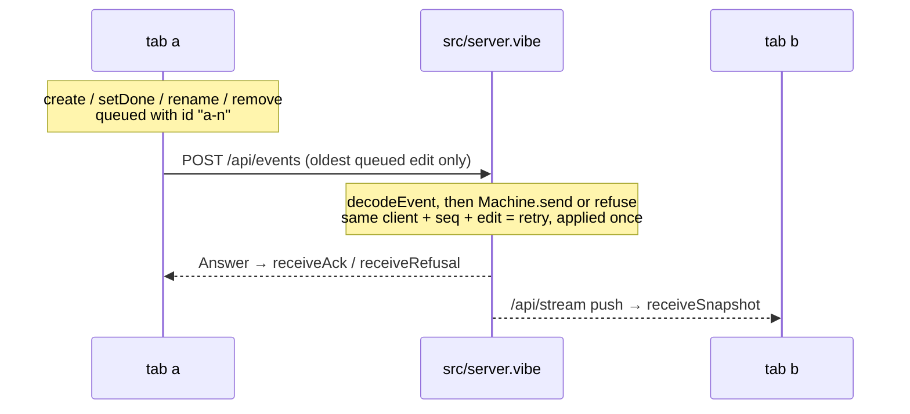

# Shared to-do list, modelled end to end

A Node.js backend and a React page share one to-do list between browser tabs
that may go offline. Both run the machines generated from `spec/`; a fourth
spec puts the server, two tabs and an unreliable network together.

```sh
pnpm install --ignore-workspace   # here, after the install at the repository root
pnpm check      # the whole pipeline (from this directory)
pnpm test       # the tests alone, against the real server on a free port
pnpm start      # build, then open http://localhost:3000 in two windows
```

Needs Node 26+ and Dafny on the path. The page loads React 18 from esm.sh.

| Path | Kind | Covers |
|---|---|---|
| `spec/todo.md` | library | A to-do, the four edits, when an edit makes sense, how it is applied |
| `spec/server.md` | machine | One request per edit, answered once, version = number of changes, ids never reused |
| `spec/client.md` | machine | One tab: confirmed copy, queue of unanswered edits, offline, answers and pushes |
| `spec/system.md` | machine | Server + tabs `a` and `b` + a lossy, repeating, reordering network + forged requests |
| `spec/*.proof.dfy` | proofs | What Dafny could not prove alone |
| `src/server.vibe`, `src/main.vibe` | backend shell | `POST /api/events`, `GET /api/snapshot`, `GET /api/stream`, the page's files |
| `src/protocol.vibe` | shared shell | Wire format |
| `src/web/` | frontend shell | React page (`app.ts`) and the `Tab` service (`sync.vibe`) it shares with `test/e2e.test.vibe` |



## VibeLang and TypeScript

The shell is [VibeLang](https://github.com/smithersai/vibelang) (`.vibe`):
TypeScript syntax for Effect, on `gen/<name>.effect.vibe`, which `pnpm gen`
writes beside each generated module. The server is Effect's `HttpRouter` over
the generated `Machine` service; a tab changes its `Client` only with `apply`.

| Stays TypeScript | Why |
|---|---|
| `gen/*.ts` | generated, and what the proofs are about |
| `src/web/app.ts` | the DOM, which a `.vibe` file cannot touch; it runs the tab's effects through a `ManagedRuntime` |
| `bundle.ts`, `vitest.config.ts` | configuration that esbuild and Vitest load themselves |

A browser cannot load the compiler's output as it is (it imports `effect` by
name), so `bundle.ts` has esbuild bundle `src/web/app.ts` and the `.vibe`
files it imports into `dist/web/app.js`, served beside `index.html`. Vitest
runs `bundle.ts` before the tests, so `pnpm test` needs no build.

## Proved, simulated, tested, trusted

- **Proved**: every transition of server, client and system keeps every
  `always` and `step` rule, and every law holds. `pnpm check` gives the count.
- **Simulated**: the `sometimes` rules, among them that both tabs can finish
  their edits and agree with the server despite loss, duplication and reordering.
- **Tested**: the HTTP shell and two tabs against the real server (`test/`).
- **Trusted**: `src/`, React, Effect, the VibeLang compiler, the generator,
  Dafny and Quint.

## Limits of the spec language met here

- **A machine cannot be imported with `.*`**; the system spec uses `S::` and `C::`.
- **Proofs about an imported machine's transitions cannot be reused**, so the
  server and client restate "a commit / refusal / queued edit / answer keeps
  the rules" as laws, which `system.proof.dfy` calls.
- **No equality on records or lists**: `sameTodos` is a fold with a position counter.
- **No list indexing besides `nth`**: taking the i-th message off the network is a fold (`dropAt`).
- **Folds over records need a named type**, hence `Walk` and `Cut`.
- **A helper that takes the state first and returns it is a transition**, so
  `commit`, `queue` and `withClient` take it second.
